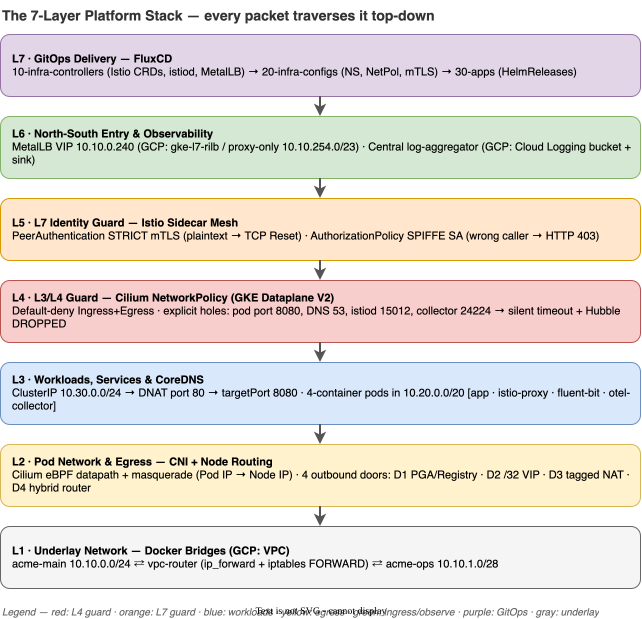
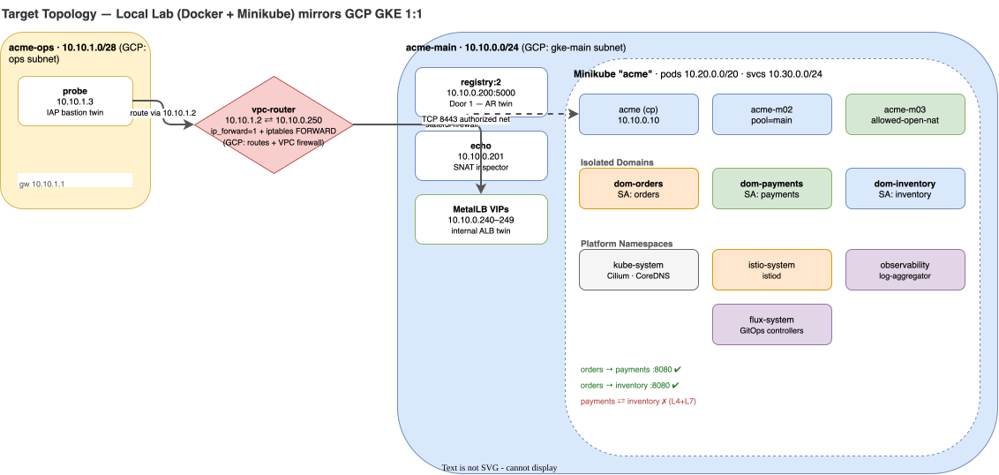

# Acme Labs: Docker → Minikube → GKE Platform Engineering Playbook

> **Visual, Hands-On, Zero-Fluff Architecture & Lab Site**  
> Build an enterprise-grade Kubernetes platform locally on **Docker + Minikube** so that deploying to **GCP GKE** (Phases P3–P9) is a 1:1 muscle-memory replay.

---

## Quick Navigation

| Section | Focus | Direct Link |
|---|---|---|
| **Reference & Cheat Sheets** | Architectural Decisions (ADRs), Handy Commands, Failure Triage, GCP Rosetta Stone | [00 - Architecture & ADRs](reference/00-architecture-decisions.md) · [01 - Command Cheat Sheet](reference/01-command-cheatsheet.md) · [02 - Failure Triage Matrix](reference/02-failure-triage-matrix.md) · [03 - Local-to-GCP Rosetta Stone](reference/03-gcp-rosetta-stone.md) |
| **Part A: Underlay & Cluster** | Docker VPC/Subnets, Router, Stateful Firewalls, Minikube IPAM, Cilium eBPF | [Lab 01: Docker Underlay & Firewalls](labs/lab-01-docker-underlay-routing.md) · [Lab 02: Minikube IPAM & Cilium CNI](labs/lab-02-minikube-ipam-cilium.md) |
| **Part B: Workloads & Egress** | Services, DNAT, CoreDNS, Multi-Container Docker/Helm, Egress & The 4 Doors | [Lab 03: Services, DNS & App Packaging](labs/lab-03-services-dns-packaging.md) · [Lab 04: Egress & The 4 Outbound Doors](labs/lab-04-egress-four-doors.md) |
| **Part C: Zero-Trust Security** | L3/L4 Cilium NetworkPolicy + Hubble, L7 Istio Sidecar mTLS + SPIFFE AuthZ | [Lab 05: L3/L4 Zero-Trust NetworkPolicy](labs/lab-05-l3-l4-network-policy.md) · [Lab 06: L7 Istio mTLS & SPIFFE AuthZ](labs/lab-06-l7-istio-mtls-authz.md) |
| **Part D: Observe, Enter & GitOps** | 4-Container Pod Logging, MetalLB Ingress Gauntlet, FluxCD Dependency Ordering | [Lab 07: 4-Container Pod & Central Logs](labs/lab-07-sidecars-central-logging.md) · [Lab 08: North-South Ingress Gauntlet](labs/lab-08-ingress-metallb-gateway.md) · [Lab 09: FluxCD GitOps Ordering](labs/lab-09-gitops-flux-ordering.md) |
| **Part E: Production Handoff** | Disposable Cold-Rebuild Script & GKE Terraform Handoff Checklist | [Lab 10: Cold Rebuild & GKE Handoff](labs/lab-10-cold-rebuild-gke-handoff.md) |
| **Planning (Original Docs)** | The source plans & design deck this site expands into labs | [GKE Plan](planning/acme-labs-plan.md) · [Minikube Plan](planning/acme-labs-minikube-learning-plan.md) · [kind Lab](planning/acme-labs-k8s-on-docker-practice.md) · [Design Deck](planning/design-deck.md) |

---

## 1. The Master Mental Model: The 7-Layer Platform Stack

Every packet in your local lab and on GCP GKE traverses this exact dependency stack. When something breaks, **identify the layer from the error signature before running a single command**.



---

## 2. Target Topology: Local Lab vs GCP GKE Twin



---

## 3. Why This Lab Order Works (And Tweaks Made to Your Original Plan)

To make the concepts stick permanently and transfer directly to GCP GKE, we refined the flow with **four key improvements**:

1. **Docker Underlay First (Lab 01 before Minikube):** Instead of treating Docker as a black box, you first build two isolated Docker bridge networks (`acme-main` and `acme-ops`), connect them with a dual-homed `vpc-router` container, and write raw `ip route` + stateful `iptables` rules. Once you see `conntrack` drop an asymmetric packet in Docker, GCP VPC Routes and Firewall rules become trivial.
2. **Local Registry Mirror as "Door 1" (Lab 03 & Lab 04):** Your original plan noted that Door 1 (Private Google Access) had no local equivalent. We added a **local Docker Registry container (`10.10.0.200:5000`)** on `acme-main` + a `/32` route so that when you delete the default internet route in Lab 04, your nodes can still pull images privately—mirroring **GCP Artifact Registry over Private Google Access**.
3. **Cilium CNI with Hubble Observability (Lab 02 & Lab 05):** Minikube's built-in `--cni=cilium` uses cluster-pool IPAM by default and skips Hubble. We install Cilium via **Helm with `ipam.mode=kubernetes` and Hubble enabled**, giving you 1:1 parity with **GKE Dataplane V2** and real-time `hubble observe --verdict DROPPED` packet inspection.
4. **Every Lab Follows the 4-Step Architect's Loop:**
   - **Architecture Decision (Why):** Trade-offs and when to choose Option A vs Option B.
   - **Visual Blueprint:** Mermaid topology or sequence diagram of the exact packet/control flow.
   - **Hands-On Build & Verify:** Copy-pasteable commands with expected outputs.
   - **Deliberate Break & Triage Drill:** Break the layer on purpose, capture the exact error text, and prove the fix.

---

## 4. Prerequisites & Workstation Setup (macOS / Linux)

Run this once to install all CLI tools and initialize your local workspace:

```bash
# 1. Install CLI toolchain (macOS Homebrew)
brew install minikube kubectl helm cilium-cli hubble istioctl fluxcd/tap/flux jq

# 2. Verify versions & Docker daemon resources (allocate >= 8 GB RAM, 4 CPUs in Docker Desktop)
docker info --format 'CPUs: {{.NCPU}} | Memory: {{.MemTotal}}'
minikube version
kubectl version --client
helm version --short
cilium version --client
istioctl version --remote=false
flux --version

# 3. Create working directory for lab manifests and scripts
mkdir -p ~/acme-k8s-lab/{scripts,manifests,charts,apps}
cd ~/acme-k8s-lab
```

> **macOS Docker Desktop Rule #1:** On macOS, Docker runs inside a lightweight Linux VM. Your Mac host terminal **cannot** directly `ping` or `curl` container IPs (`10.10.0.x` or `10.10.1.x`). Always run network tests from the **`probe` container** (`docker exec probe ...`) or inside the cluster (`kubectl exec ...`).

---

## 5. How to View This Site as an Interactive Web App

This directory is a **MkDocs Material** site with color-coded **draw.io architecture diagrams** (editable `.drawio.svg` files in `docs/diagrams/`), Mermaid sequence diagrams, tabbed navigation, full-text search, and one-click code copy buttons.

```bash
# From this directory — live-reload dev server
mkdocs serve
# Open http://127.0.0.1:8000 in your browser

# Static build (output goes to site/)
mkdocs build
```
