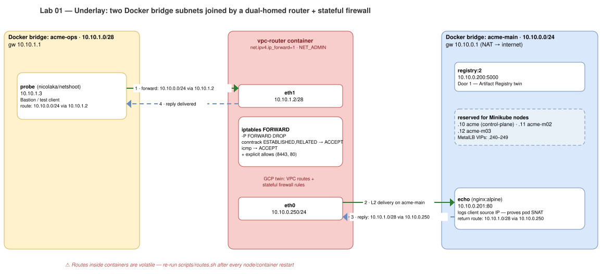
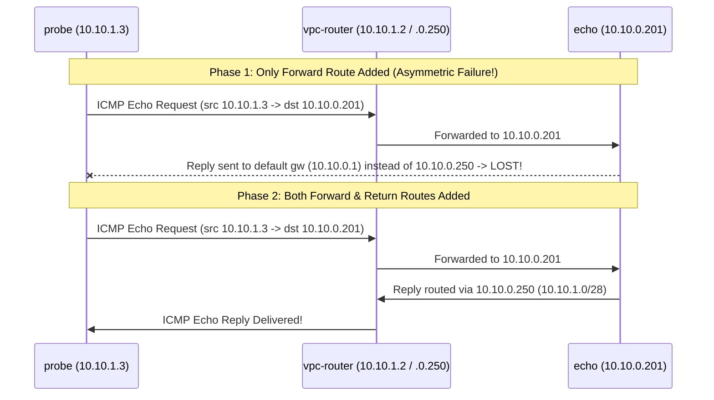

# Lab 01 · Docker Underlay: VPC Subnets, Next-Hop Routing & Stateful Firewalls

> **Core Lesson:** Kubernetes **sits on top of** the network; it cannot create VPCs, subnets, route tables, or cloud firewalls. Before starting Minikube, you will build the underlay network yourself using two Docker bridge subnets, a dual-homed Linux router container (`vpc-router`), and `iptables` connection tracking.  
> **GCP Twin:** Phase P3 (`google_compute_network`, `google_compute_subnetwork`, `google_compute_route`, `google_compute_firewall`, IAP bastion VM).

[RFC 1918 — Address Allocation for Private Internets](https://www.rfc-editor.org/info/rfc1918)
---

## 1. Architecture Decision: Where Does Underlay End and Kubernetes Begin?

| Question | Architect's Answer |
|---|---|
| **Why build two Docker networks (`acme-main` + `acme-ops`)?** | A single subnet hides routing bugs because every host is L2-adjacent (ARP). Separating the bastion (`acme-ops` `10.10.1.0/28`) from the cluster (`acme-main` `10.10.0.0/24`) forces every admin and ingress packet through a **Layer 3 next hop** and a **stateful firewall**—just like an enterprise Bastion/VPN subnet talking to GKE. |
| **Why do we need `conntrack ESTABLISHED,RELATED` on the firewall?** | GCP VPC Firewalls are **stateful**: if you allow `probe -> API Server (6443)`, the return packet (`6443 -> probe`) is automatically allowed. Raw `iptables` with `FORWARD DROP` is **stateless** until you explicitly add a `conntrack` rule. Forgetting this creates the classic "one-way ping / asymmetric drop" bug. |
| **Why pre-deploy a local registry (`10.10.0.200`) and echo server (`10.10.0.201`)?** | In Lab 04, we will delete the default internet route (`0.0.0.0/0`). Having `10.10.0.200:5000` on `acme-main` gives us a local twin of **GCP Artifact Registry over Private Google Access (Door 1)**, and `echo` (`10.10.0.201`) logs client source IPs to prove Pod SNAT/masquerade. |

---

## 2. Visual Blueprint: The Underlay Topology



---

## 3. Step-by-Step Hands-On Build

### Step 1: Create the Two Subnets (`acme-main` & `acme-ops`)

```bash
cd ~/acme-k8s-lab

# Create primary cluster subnet (10.10.0.0/24) and ops/bastion subnet (10.10.1.0/28)
docker network create --driver bridge --subnet 10.10.0.0/24 --gateway 10.10.0.1 acme-main
docker network create --driver bridge --subnet 10.10.1.0/28 --gateway 10.10.1.1 acme-ops

# Verify both networks exist with exact CIDRs
docker network inspect acme-main acme-ops \
  --format '{{.Name}}: {{range .IPAM.Config}}{{.Subnet}} (gw {{.Gateway}}){{end}}'
```

**Expected Output:**
```text
acme-main: 10.10.0.0/24 (gw 10.10.0.1)
acme-ops: 10.10.1.0/28 (gw 10.10.1.1)
```

notes:

In any standard IPv4 subnet (like 10.10.0.0/24), two IP addresses are reserved and cannot be assigned to individual devices, but they aren't for the gateway:1. The Reserved IP AddressesNetwork Address: 10.10.0.0Purpose: Identifies the network itself.Broadcast Address: 10.10.0.255Purpose: Used to send data packets to every device on this subnet simultaneously.Where does the Gateway go?The default gateway (your router) is actually a standard host device on the network. It requires an assignable host IP address.By convention/best practice, network administrators typically assign the default gateway to either:The first usable IP: 10.10.0.1The last usable IP: 10.10.0.254Quick Summary Table for 10.10.0.0/24AddressTypeAssignable to a device?10.10.0.0Network Identifier❌ Reserved10.10.0.1First Usable IP (often assigned to Gateway)✅ Yes10.10.0.2 – 10.10.0.254Usable Host IPs✅ Yes10.10.0.255Broadcast Address❌ Reserved

Gateway (10.10.0.1): Acts as the default router for any container on the acme-main network. When a container needs to talk to the outside world or another network, it sends traffic here.

Usable Container IPs (10.10.0.2 through 10.10.0.254): These are the addresses Docker can dynamically assign or statically bind to your containers.

Network (10.10.0.0) & Broadcast (10.10.0.255): Still reserved and blocked from assignment, just as discussed.

---

### Step 2: Launch `vpc-router`, `probe`, `registry`, and `echo`

```bash
# 1. Dual-homed router container with IPv4 forwarding enabled
docker run -d --name vpc-router \
  --cap-add NET_ADMIN \
  --sysctl net.ipv4.ip_forward=1 \
  --network acme-main --ip 10.10.0.250 \
  nicolaka/netshoot sleep infinity

# Attach second NIC on acme-ops
docker network connect --ip 10.10.1.2 acme-ops vpc-router

# 2. Ops bastion ("probe") in acme-ops
docker run -d --name probe \
  --cap-add NET_ADMIN \
  --network acme-ops --ip 10.10.1.3 \
  nicolaka/netshoot sleep infinity

# 3. Private Registry ("Door 1" Artifact Registry stand-in) on acme-main
docker run -d --name registry \
  --network acme-main --ip 10.10.0.200 \
  registry:2

# 4. Echo server (logs client source IPs) with NET_ADMIN so we can add return routes
docker run -d --name echo \
  --cap-add NET_ADMIN \
  --network acme-main --ip 10.10.0.201 \
  nginx:alpine
```

Verify the router has **two interfaces** (`eth0` on `10.10.0.250/24` and `eth1` on `10.10.1.2/28`):

```bash
docker exec vpc-router ip -br addr
```

---

### Step 3: Observe Asymmetric Routing Failure, Then Wire Next-Hop Routes

Right now, `probe` (`10.10.1.3`) only knows its default gateway (`10.10.1.1`). If it pings `echo` (`10.10.0.201`), the packet goes to Docker's bridge gateway instead of `vpc-router`.



Run this hands-on proof:

```bash
# 1. Add ONLY the forward route on probe:
docker exec probe ip route add 10.10.0.0/24 via 10.10.1.2

# 2. Try to ping echo (Fails! Because echo doesn't know how to reach 10.10.1.0/28)
docker exec probe ping -c 1 -W 2 10.10.0.201 || echo "EXPECTED FAIL: Missing return route on echo"

# 3. Now add the return route on echo and test again:
docker exec echo ip route add 10.10.1.0/28 via 10.10.0.250
docker exec probe ping -c 2 10.10.0.201
docker exec probe curl -sI http://10.10.0.201 | head -n 1
```

---

### Step 4: Enforce a Stateful Firewall on `vpc-router` (GCP VPC Firewall Twin)

By default, Linux `FORWARD` policy is `ACCEPT` (everything talks to everything). On GCP, VPC ingress is **deny-all by default**, and you open specific ports via `google_compute_firewall`. Let's configure `vpc-router` to match GCP:

```bash
# 1. Default DENY all routed traffic between subnets
docker exec vpc-router iptables -F FORWARD
docker exec vpc-router iptables -P FORWARD DROP

# 2. Make the firewall STATEFUL (allow return packets for established flows)
docker exec vpc-router iptables -A FORWARD -m conntrack --ctstate ESTABLISHED,RELATED -j ACCEPT

# 3. Allow ICMP (ping) for diagnostics
docker exec vpc-router iptables -A FORWARD -p icmp -j ACCEPT

# 4. Verify: Ping works, but HTTP (port 80) to echo is BLOCKED!
docker exec probe ping -c 1 10.10.0.201
docker exec probe curl -sS -m 3 -o /dev/null -w 'HTTP Code: %{http_code}\n' http://10.10.0.201 || echo "Blocked by firewall as expected"

# 5. Inspect packet drop counters on vpc-router
docker exec vpc-router iptables -L FORWARD -n -v --line-numbers
```

---

### Step 5: Save Your Reusable `scripts/routes.sh`

Because container routing tables live in volatile kernel memory, restarting a container or Minikube node wipes manual routes. Save this idempotent script right now:

```bash
cat << 'EOF' > ~/acme-k8s-lab/scripts/routes.sh
#!/usr/bin/env bash
set -euo pipefail

echo "[*] Applying underlay routes across acme-ops and acme-main..."

# 1. Forward route on probe -> acme-main via vpc-router
docker exec probe ip route replace 10.10.0.0/24 via 10.10.1.2

# 2. Return route on helper containers -> acme-ops via vpc-router
for c in echo; do
  if docker ps --format '{{.Names}}' | grep -qx "$c"; then
    docker exec "$c" ip route replace 10.10.1.0/28 via 10.10.0.250
  fi
done

# 3. Return route on all running Minikube nodes in profile 'acme'
for n in $(docker ps --filter "label=name.minikube.sigs.k8s.io=acme" --format '{{.Names}}'); do
  echo " -> Adding return route 10.10.1.0/28 on node $n"
  docker exec "$n" ip route replace 10.10.1.0/28 via 10.10.0.250
done

echo "[✓] All routes synchronized."
EOF
chmod +x ~/acme-k8s-lab/scripts/routes.sh
~/acme-k8s-lab/scripts/routes.sh
```

---

## 4. Deliberate Break & Triage Drills

Run each break, observe the exact symptom, and restore:

### Drill 1: The Stateless Firewall Trap (Missing `ESTABLISHED,RELATED`)
```bash
# Temporarily allow port 80 from probe -> echo, but DELETE the conntrack rule (Rule #1)
docker exec vpc-router iptables -A FORWARD -s 10.10.1.3 -d 10.10.0.201 -p tcp --dport 80 -j ACCEPT
docker exec vpc-router iptables -D FORWARD 1

# Test: SYN goes through, echo sends SYN-ACK, router DROPS the SYN-ACK!
docker exec probe curl -sS -m 3 http://10.10.0.201 || echo "Timed out - Return SYN-ACK dropped"

# Restore conntrack at Rule #1 and remove temporary port 80 rule:
docker exec vpc-router iptables -I FORWARD 1 -m conntrack --ctstate ESTABLISHED,RELATED -j ACCEPT
docker exec vpc-router iptables -D FORWARD -s 10.10.1.3 -d 10.10.0.201 -p tcp --dport 80 -j ACCEPT
```

---

## 5. Readiness Gate G-01

Before moving to **Lab 02**, verify you can answer without looking:
1. Why did `ping` fail when only `probe` had a route to `10.10.0.0/24`? *(Packets must route in both directions; `echo` sent replies to `10.10.0.1` instead of `10.10.0.250`).*
2. What is the difference between `Connection refused` and `Connection timed out (000)` across a firewall? *(`DROP` discards the SYN silently → client waits for timeout; `REJECT` or a closed port with an open firewall sends TCP RST → immediate `Connection refused`).*

---
**Next Step:** [Lab 02 · Minikube Cluster, IPAM & Cilium CNI Dataplane →](lab-02-minikube-ipam-cilium.md)
