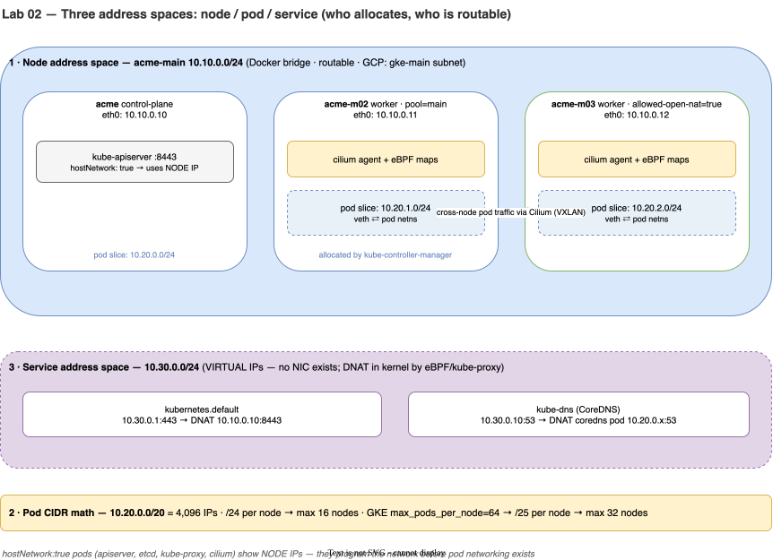

# Lab 02 · Minikube Cluster, IPAM & Cilium eBPF Dataplane

> **Core Lesson:** Design your 3 address spaces (Node, Pod, Service) before booting the cluster, attach Minikube to your existing `acme-main` VPC subnet, install **Cilium via Helm with Kubernetes IPAM and Hubble**, and prove how authorized networks control access to the Kubernetes API server.  
> **GCP Twin:** Phase P3 & P4 (`ip_allocation_policy`, `max_pods_per_node`, `datapath_provider = "ADVANCED_DATAPATH"`, `master_authorized_networks_config`).

---

## 1. Architecture Decision: IPAM & CNI Wiring

| Decision Point | Choice Made | Why It Matters on GCP GKE |
|---|---|---|
| **How are Pod IPs allocated?** | `kube-controller-manager` carves `10.20.0.0/20` into `/24` per-node slices (`node.spec.podCIDR`), and Cilium runs with `ipam.mode=kubernetes`. | On GKE VPC-Native clusters, GKE carves the `gke-pods` secondary range (`10.20.0.0/20`) into per-node alias IP ranges based on `max_pods_per_node`. Using `ipam.mode=kubernetes` locally ensures your pods get `10.20.x.x` IPs instead of Cilium's private `10.0.x.x` default pool! |
| **Why install Cilium via Helm instead of `minikube start --cni=cilium`?** | Start Minikube with `--cni=bridge` (or minimal CNI), then install Cilium via Helm with `hubble.relay.enabled=true`. | Minikube's built-in `--cni=cilium` manifest uses `cluster-pool` IPAM (ignoring `10.20.0.0/20`) and disables Hubble. Installing via Helm gives you **exact CIDR parity** + **`hubble observe`** for L3/L4 packet debugging. |
| **Why 3 Nodes (`acme`, `acme-m02`, `acme-m03`)?** | 1 Control Plane (`10.10.0.10`) + 2 Workers (`acme-m02`, `acme-m03`). | Lets you test cross-node pod traffic (Lab 02), and in Lab 04 we will label `acme-m03` with `allowed-open-nat=true` (Door 3) while keeping `acme-m02` locked down. |

---

## 2. Visual Blueprint: The 3 Address Spaces & eBPF Datapath



### CIDR Capacity Math (Do This Before Every Cluster Build)
* **Pod CIDR:** `10.20.0.0/20` = $2^{32-20} = 4,096$ total IPs.
* **Per-Node Slice (Default `/24`):** $2^{32-24} = 256$ IPs per node → $\frac{4096}{256} =$ **16 nodes maximum**.
* **GKE Optimization (`max_pods_per_node = 64`):** GKE allocates a `/25` ($128$ IPs,always $2 \times \text{max\_pods}$) per node → $\frac{4096}{128} =$ **32 nodes maximum**.

---

## 3. Step-by-Step Hands-On Build

### Step 1: Boot the 3-Node Minikube Cluster on `acme-main`

```bash
# Start 3-node cluster attached to acme-main with explicit CIDRs
minikube start -p acme \
  --driver=docker \
  --container-runtime=containerd \
  --nodes=3 \
  --cpus=2 --memory=3072 \
  --network=acme-main \
  --static-ip=10.10.0.10 \
  --service-cluster-ip-range=10.30.0.0/24 \
  --extra-config=kubeadm.pod-network-cidr=10.20.0.0/20 \
  --extra-config=controller-manager.allocate-node-cidrs=true \
  --cni=bridge

# Ensure kubectl context points to 'acme'
kubectl config use-context acme

# Wire return routes on the 3 new Minikube nodes so acme-ops (probe) can talk to them
~/acme-k8s-lab/scripts/routes.sh
```

---

### Step 2: Install Cilium CNI + Hubble (GKE Dataplane V2 Engine)

```bash
helm repo add cilium https://helm.cilium.io && helm repo update

# Remove default bridge CNI config on nodes so Cilium becomes the primary CNI
for n in $(minikube node list -p acme | awk '{print $1}'); do
  docker exec "$n" sh -c 'rm -f /etc/cni/net.d/*bridge* /etc/cni/net.d/*kindnet* /etc/cni/net.d/10-containerd*' || true
done

# Install Cilium using Kubernetes node.spec.podCIDR allocation (10.20.0.0/20)
helm upgrade --install cilium cilium/cilium -n kube-system \
  --set ipam.mode=kubernetes \
  --set routingMode=tunnel \
  --set tunnelProtocol=vxlan \
  --set devices=eth0 \
  --set hubble.relay.enabled=true \
  --set hubble.ui.enabled=true

# Wait for Cilium DaemonSet and restart CoreDNS so all pods get 10.20.x.x IPs
kubectl -n kube-system rollout status ds/cilium --timeout=300s
kubectl -n kube-system rollout restart deploy/coredns
kubectl -n kube-system rollout status deploy/coredns --timeout=120s

# Label worker nodes to mirror GKE node pools and network tags
kubectl label node acme-m02 pool=main --overwrite
kubectl label node acme-m03 pool=main allowed-open-nat=true --overwrite
```

---

### Step 3: Prove the 3 Address Spaces with Evidence

Run these four commands and verify every range matches your IPAM blueprint:

```bash
# 1. Node IPs (10.10.0.10, .11, .12) and Per-Node Pod CIDRs (10.20.0.0/24, 10.20.1.0/24, 10.20.2.0/24)
kubectl get nodes -o custom-columns=\
NAME:.metadata.name,\
NODE_IP:.status.addresses[0].address,\
POD_CIDR:.spec.podCIDR,\
POOL:.metadata.labels.pool,\
NAT_TAG:.metadata.labels.allowed-open-nat

# 2. Service CIDR (kubernetes.default = 10.30.0.1, kube-dns = 10.30.0.10)
kubectl get svc -A

# 3. Pod IPs: Notice which pods have Node IPs (10.10.0.x) vs Pod IPs (10.20.x.x)!
kubectl get pods -n kube-system -o custom-columns=\
NAME:.metadata.name,IP:.status.podIP,NODE:.spec.nodeName,HOST_NET:.spec.hostNetwork

# 4. Cilium status & endpoint table
kubectl -n kube-system exec ds/cilium -- cilium status --brief
```

> **Architect's Observation:** Why do `kube-apiserver`, `etcd`, `kube-proxy`, and `cilium` show `10.10.0.x` (Node IP) instead of `10.20.x.x`? Because they set `hostNetwork: true`—they must run in the node's root network namespace to program the networkbefore any Pod network exists!

---

### Step 4: Configure Registry Trust on Nodes (Prep for Door 1 in Lab 03/04)

Configure `containerd` on all three Minikube nodes to allow pulling from our HTTP local registry (`10.10.0.200:5000`) on `acme-main`:

```bash
for n in acme acme-m02 acme-m03; do
  docker exec "$n" bash -c '
    mkdir -p /etc/containerd/certs.d/10.10.0.200:5000
    cat <<EOF > /etc/containerd/certs.d/10.10.0.200:5000/hosts.toml
server = "http://10.10.0.200:5000"
[host."http://10.10.0.200:5000"]
  capabilities = ["pull", "resolve", "push"]
  skip_verify = true
EOF'
done
```

---

### Step 5: Master Authorized Networks Drill (`probe` → Control Plane API)

In Lab 01, we set `iptables -P FORWARD DROP` on `vpc-router`. Let's test whether `probe` (`10.10.1.3` in `acme-ops`) can reach the Minikube Kubernetes API server (`https://10.10.0.10:8443/version`):

```bash
# 1. Predict first: What will curl return right now? (Answer: 000 timeout — blocked by vpc-router!)
docker exec probe curl -sk -m 3 -o /dev/null -w '%{http_code}\n' https://10.10.0.10:8443/version || true

# 2. Authorize probe's IP (10.10.1.3) to reach the Control Plane on TCP 8443
#    (GCP Twin: master_authorized_networks_config cidr_blocks = ["10.10.1.3/32"])
docker exec vpc-router iptables -A FORWARD -s 10.10.1.3 -d 10.10.0.10 -p tcp --dport 8443 -j ACCEPT

# 3. Re-test: Now returns HTTP 200 (or 401/403 from apiserver RBAC, proving TCP + TLS connected!)
docker exec probe curl -sk -m 3 -o /dev/null -w 'HTTP Status: %{http_code}\n' https://10.10.0.10:8443/version
docker exec probe curl -sk https://10.10.0.10:8443/version
```

---

## 4. Deliberate Break & Triage Drills

### Drill 1: Trace Cross-Node Pod Encapsulation with `tcpdump`
Let's see how a pod on `acme-m02` (`10.20.1.x`) talks to a pod on `acme-m03` (`10.20.2.x`):

```bash
# Schedule two netshoot pods on different worker nodes
kubectl run pod-m02 --image=nicolaka/netshoot \
  --overrides='{"spec":{"nodeSelector":{"kubernetes.io/hostname":"acme-m02"}}}' -- sleep 3600
kubectl run pod-m03 --image=nicolaka/netshoot \
  --overrides='{"spec":{"nodeSelector":{"kubernetes.io/hostname":"acme-m03"}}}' -- sleep 3600
kubectl wait --for=condition=ready pod/pod-m02 pod/pod-m03 --timeout=90s

IP_M03=$(kubectl get pod pod-m03 -o jsonpath='{.status.podIP}')
echo "pod-m03 IP is $IP_M03"

# Ping from pod-m02 -> pod-m03 while inspecting Hubble
kubectl exec pod-m02 -- ping -c 2 "$IP_M03"
kubectl -n kube-system exec ds/cilium -- hubble observe --protocol icmp --last 5

# Clean up test pods
kubectl delete pod pod-m02 pod-m03 --wait=false
```

---

## 5. Readiness Gate G-02

Verify you can answer from memory:
1. Why can a second cluster on the same VPC **never** share `10.20.0.0/20` if the networks are routed together? *(Both clusters allocate overlapping `10.20.0.x` pod IPs; return traffic routes to the wrong cluster).*
2. Which Kubernetes component assigns `10.20.1.0/24` to `acme-m02`, and which component assigns `10.20.1.15` to an individual Pod on that node? *(`kube-controller-manager` assigns the `/24` `podCIDR` to the Node object; the local CNI IPAM plugin on `acme-m02` assigns individual IPs from that `/24` to Pods).*

---
**Next Step:** [Lab 03 · Services, CoreDNS & App Packaging with Docker/Helm →](lab-03-services-dns-packaging.md)
