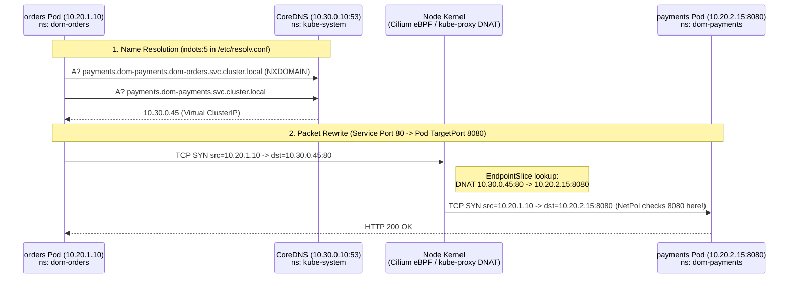

# Lab 03 · Services, CoreDNS & Reusable Helm Packaging Across 3 Domains

> **Core Lesson:** Understand how a virtual `ClusterIP` (`10.30.0.0/24`) is rewritten via kernel DNAT (`port 80` → `targetPort 8080`), how CoreDNS `ndots:5` search domains work, and how to package three domains (`orders`, `payments`, `inventory`) using **one reusable Tier-2 Helm chart** (`acme-microservice`).  
> **GCP Twin:** Phase P7a–P7c (`helm-charts/acme-microservice`, `dom-orders`, `dom-payments`, `dom-inventory`, Workload Identity KSA annotations).

---

## 1. Architecture Decision: One Reusable Chart vs Copy-Pasted Manifests

| Decision Point | Choice Made | Why It Matters |
|---|---|---|
| **Why build ONE Helm chart (`acme-microservice`) for 3 different domains?** | Tier-2 platform chart parameterized by `domain`, `image.*`, `serviceAccount.gsaEmail`, and `sidecars.*` toggles. | In an enterprise with 50 microservices, copy-pasting Deployment YAML means 50 PRs whenever you upgrade Fluent Bit, change OTel configs, or add security contexts. One Tier-2 chart enforces platform standards everywhere. |
| **Why separate Service `port: 80` from Container `targetPort: 8080`?** | Callers dial standard HTTP (`http://payments.dom-payments` on port `80`), while containers run as **non-root user (`UID > 1000`)** on unprivileged port `8080`. | Running containers as root just to bind port 80 violates Pod Security Standards (`restricted`). **Crucial Nuance:** Kernel DNAT happens *before* `NetworkPolicy` evaluation, so L4 policies in Lab 05 must allow **Pod `targetPort: 8080`**, not Service `port: 80`! |
| **Why observe the flat network first?** | Deploy all 3 domains before applying `NetworkPolicy`. | Proves that Kubernetes **allows every namespace to call every namespace by default** (`payments` can call `inventory`), which is why multi-tenant clusters require explicit L4 + L7 guards. |

---

## 2. Visual Blueprint: Service DNAT, CoreDNS `ndots:5` & The 3 Domains



---

## 3. Step-by-Step Hands-On Build

### Step 1: Preload & Push Base Images to Your Local Registry (`10.10.0.200:5000`)

We preload `nginxinc/nginx-unprivileged:alpine` (listens on `8080`, includes `wget`) and `curlimages/curl` into both the Minikube nodes **and** our local registry (`10.10.0.200:5000`) so they survive when we cut internet access in Lab 04:

```bash
# Pull images on host
docker pull nginxinc/nginx-unprivileged:alpine
docker pull curlimages/curl:latest
docker pull fluent/fluent-bit:3.2
docker pull otel/opentelemetry-collector:0.114.0

# Load into Minikube nodes
minikube image load -p acme nginxinc/nginx-unprivileged:alpine
minikube image load -p acme curlimages/curl:latest
minikube image load -p acme fluent/fluent-bit:3.2
minikube image load -p acme otel/opentelemetry-collector:0.114.0

# Also push our microservice image into the local registry (10.10.0.200:5000) via probe/host
docker tag nginxinc/nginx-unprivileged:alpine localhost:5000/acme/service:v1
```

---

### Step 2: Create the Reusable Tier-2 Helm Chart (`charts/acme-microservice`)

Create the chart once. Notice how `sidecars.fluentbit.enabled` and `sidecars.otel.enabled` are built-in toggles (off in Lab 03, turned on in Lab 07) and `serviceAccount.gsaEmail` prepares for GKE Workload Identity:

```bash
mkdir -p ~/acme-k8s-lab/charts/acme-microservice/templates

cat << 'EOF' > ~/acme-k8s-lab/charts/acme-microservice/Chart.yaml
apiVersion: v2
name: acme-microservice
description: Tier-2 Reusable Platform Helm Chart for Acme Labs Domains
type: application
version: 0.1.0
appVersion: "1.0.0"
EOF

cat << 'EOF' > ~/acme-k8s-lab/charts/acme-microservice/values.yaml
domain: orders
replicas: 1
image:
  repository: nginxinc/nginx-unprivileged
  tag: alpine
  pullPolicy: IfNotPresent
service:
  port: 80
  targetPort: 8080
serviceAccount:
  gsaEmail: ""   # On GCP: orders-app@my-devops-journey-502420.iam.gserviceaccount.com
resources:
  requests:
    cpu: 50m
    memory: 64Mi
  limits:
    memory: 128Mi
sidecars:
  fluentbit:
    enabled: false
    image: fluent/fluent-bit:3.2
  otel:
    enabled: false
    image: otel/opentelemetry-collector:0.114.0
EOF

cat << 'EOF' > ~/acme-k8s-lab/charts/acme-microservice/templates/all.yaml
apiVersion: v1
kind: ServiceAccount
metadata:
  name: {{ .Values.domain }}
  namespace: dom-{{ .Values.domain }}
  {{- if .Values.serviceAccount.gsaEmail }}
  annotations:
    iam.gke.io/gcp-service-account: {{ .Values.serviceAccount.gsaEmail | quote }}
  {{- end }}
---
apiVersion: v1
kind: Service
metadata:
  name: {{ .Values.domain }}
  namespace: dom-{{ .Values.domain }}
  labels:
    app: {{ .Values.domain }}
    domain: {{ .Values.domain }}
spec:
  selector:
    app: {{ .Values.domain }}
  ports:
    - name: http
      port: {{ .Values.service.port }}
      targetPort: {{ .Values.service.targetPort }}
---
apiVersion: apps/v1
kind: Deployment
metadata:
  name: {{ .Values.domain }}
  namespace: dom-{{ .Values.domain }}
spec:
  replicas: {{ .Values.replicas }}
  selector:
    matchLabels:
      app: {{ .Values.domain }}
  template:
    metadata:
      labels:
        app: {{ .Values.domain }}
        domain: {{ .Values.domain }}
    spec:
      serviceAccountName: {{ .Values.domain }}
      containers:
        - name: app
          image: "{{ .Values.image.repository }}:{{ .Values.image.tag }}"
          imagePullPolicy: {{ .Values.image.pullPolicy }}
          ports:
            - containerPort: {{ .Values.service.targetPort }}
          resources:
            {{- toYaml .Values.resources | nindent 12 }}
EOF

# Lint the chart to verify syntax
helm lint ~/acme-k8s-lab/charts/acme-microservice
```

---

### Step 3: Deploy All 3 Isolated Domains (`orders`, `payments`, `inventory`)

```bash
kubectl create ns observability --dry-run=client -o yaml | kubectl apply -f -

for d in orders payments inventory; do
  helm upgrade --install "$d" ~/acme-k8s-lab/charts/acme-microservice \
    --namespace "dom-$d" --create-namespace \
    --set domain="$d" \
    --set serviceAccount.gsaEmail="${d}-app@my-devops-journey-502420.iam.gserviceaccount.com"
done

# Verify all pods, Services, and EndpointSlices across the 3 domains
kubectl get pods,svc,endpointslices -n dom-orders -n dom-payments -n dom-inventory -o wide
```

---

### Step 4: Verify the Call Graph & Observe the "Flat Network" Problem

Define the `call` helper function and test East-West traffic across namespaces:

```bash
call() {
  kubectl -n "$1" exec "deploy/$2" -c app -- sh -c "wget -O /dev/null -T 3 $3 2>&1 | tail -n1"
}

# Intended calls (orders -> payments, orders -> inventory)
call dom-orders orders http://payments.dom-payments/
call dom-orders orders http://inventory.dom-inventory/

# Unintended call (payments -> inventory) — WORKS right now because K8s is flat by default!
call dom-payments payments http://inventory.dom-inventory/
```

**Expected Output for all 3:** `remote file exists` (HTTP 200).

---

### Step 5: Inspect CoreDNS `ndots:5` Search Expansion

Why did `http://payments.dom-payments/` resolve without `.svc.cluster.local`? Inspect `/etc/resolv.conf` inside `orders`:

```bash
kubectl -n dom-orders exec deploy/orders -c app -- cat /etc/resolv.conf
```

**Output:**
```text
nameserver 10.30.0.10
search dom-orders.svc.cluster.local svc.cluster.local cluster.local
options ndots:5
```

> **Architect's Performance Tip:** Because `ndots:5` is set, any hostname with fewer than 5 dots (like `payments.dom-payments`, which has 1 dot, or `api.stripe.com`, which has 2 dots) is **first appended to all 3 `search` domains** before querying the name directly! For high-QPS external calls or cross-namespace calls, adding a trailing dot (`http://payments.dom-payments.svc.cluster.local.`) saves 4 unnecessary DNS lookups per connection.

---

## 4. Deliberate Break & Triage Drills

### Drill 1: The `port` vs `targetPort` Mismatch (`Connection refused`)
```bash
# Patch payments Service targetPort to 9999 (nobody listening on 9999 inside the pod)
kubectl -n dom-payments patch svc payments --type='json' -p='[{"op":"replace","path":"/spec/ports/0/targetPort","value":9999}]'

# Call payments: Notice the immediate "Connection refused" (NOT a timeout!)
call dom-orders orders http://payments.dom-payments/ || true

# Fix it back to 8080:
kubectl -n dom-payments patch svc payments --type='json' -p='[{"op":"replace","path":"/spec/ports/0/targetPort","value":8080}]'
call dom-orders orders http://payments.dom-payments/
```

### Drill 2: Selector Mismatch (Empty `EndpointSlice`)
```bash
# Break the Service selector so it matches 0 pods
kubectl -n dom-payments patch svc payments -p '{"spec":{"selector":{"app":"wrong-label"}}}'
kubectl -n dom-payments get endpointslices

# Call fails immediately; restore selector:
kubectl -n dom-payments patch svc payments -p '{"spec":{"selector":{"app":"payments"}}}'
```

### Drill 3: The Pod Debug Flow (`get` → `describe` → `logs`)

This is the universal FDE sequence — run it for every broken pod before touching anything else:

```bash
kubectl get pods -n dom-orders                                # 1. STATE: Pending? CrashLoop? 0/1 Ready?
kubectl describe pod <pod> -n dom-orders | tail -20           # 2. EVENTS: image pull, scheduling, mounts, probes
kubectl logs <pod> -c app -n dom-orders --previous            # 3. APP: last container's own output
kubectl get events -n dom-orders --sort-by=.lastTimestamp     # 4. namespace event timeline
```

### Drill 4: `CrashLoopBackOff` — the container keeps dying

```bash
kubectl run crashy --image=nginxinc/nginx-unprivileged:alpine --image-pull-policy=IfNotPresent \
  --restart=Always -- sh -c "echo 'missing config!' && exit 1"
sleep 15
kubectl get pod crashy                                        # STATUS: CrashLoopBackOff (restarts climbing)
kubectl describe pod crashy | grep -A5 "Last State"           # Reason: Error, Exit Code: 1
kubectl logs crashy --previous                                # shows "missing config!" from the LAST crash
kubectl delete pod crashy --wait=false
```

> **FDE note:** `CrashLoopBackOff` is Kubernetes' retry backoff (1s→2s→4s…→5m cap), not a state itself — the *real* cause lives in `--previous` logs or `describe` (bad command, missing file/env, or an app that can't reach its dependency).

### Drill 5: `OOMKilled` — memory limit exceeded

```bash
kubectl run hog --image=polinux/stress --restart=Never \
  --limits=memory=64Mi -- requests="--vm 1 --vm-bytes 128M --vm-hang 60"
sleep 20
kubectl get pod hog                                           # STATUS: OOMKilled
kubectl describe pod hog | grep -A5 "Last State"              # Reason: OOMKilled — killed by kernel cgroup
kubectl delete pod hog --wait=false
```

> **Requests vs Limits:** `requests` = what the **scheduler** reserves for you (scheduling decision). `limits.memory` = hard cgroup ceiling — cross it and the kernel kills the container mid-flight (no graceful shutdown, no log flush → looks like "app randomly restarted"). CPU limits throttle instead of killing.

### Drill 6: `Pending` — the scheduler can't place the pod

```bash
kubectl run toobig --image=nginxinc/nginx-unprivileged:alpine --image-pull-policy=IfNotPresent \
  --restart=Never --requests=cpu=8,memory=8Gi -- sleep 300
sleep 10
kubectl get pod toobig                                        # STATUS: Pending (never starts)
kubectl describe pod toobig | grep -A5 Events                 # "Insufficient cpu" on every node
kubectl delete pod toobig --wait=false
```

> **FDE note:** `Pending` is a *capacity/constraint* problem, not a pod problem: requests > node allocatable, `nodeSelector` matching nothing, un-tolerated taints, or PVC that can't bind. `kubectl describe` Events always say which.

### Drill 7: Ready `0/1` — pod is up but the Service has no endpoints

```bash
# Deploy a pod whose readinessProbe checks the WRONG port
kubectl run unready --image=nginxinc/nginx-unprivileged:alpine --image-pull-policy=IfNotPresent \
  --restart=Never --overrides='{"spec":{"containers":[{"name":"unready","image":"nginxinc/nginx-unprivileged:alpine","readinessProbe":{"httpGet":{"port":9999,"path":"/"}}}]}}' -- sleep 300
sleep 10
kubectl get pod unready                                       # Running but 0/1 READY
kubectl describe pod unready | grep -A5 Events                # "Readiness probe failed: connect: connection refused"
kubectl delete pod unready --wait=false
```

> **The silent killer:** an unready pod is **removed from the Service's EndpointSlice** — callers get `no endpoints`/`connection refused` even though the pod is `Running`. On GKE this is also why a `502 Bad Gateway` from the Load Balancer usually means **health checks failing** (wrong path/port or blocked health-check ranges `130.211.0.0/22`, `35.191.0.0/16`), not an app bug.

### Drill 8: `.env` → Secret + env injection (and when you need `imagePullSecrets`)

```bash
# 1. Create a generic Secret (the K8s analog of a .env file)
kubectl -n dom-orders create secret generic app-secrets \
  --from-literal=DB_PASSWORD='s3cr3t' --from-literal=API_KEY='abc123'

kubectl -n dom-orders get secret app-secrets -o yaml          # base64 only — NOT encryption!

# 2. Inject into a pod as env vars
kubectl run secret-test -n dom-orders --rm -i --restart=Never \
  --image=nginxinc/nginx-unprivileged:alpine --image-pull-policy=IfNotPresent \
  --overrides='{"spec":{"containers":[{"name":"t","image":"nginxinc/nginx-unprivileged:alpine",
    "envFrom":[{"secretRef":{"name":"app-secrets"}}]}]}}' -- printenv | grep -E "DB_|API_"
kubectl -n dom-orders delete secret app-secrets
```

> **GCP handoff:** on GKE you stop storing real secrets in `Secret` (etcd, base64) — you keep them in **Secret Manager** and sync via **External Secrets Operator**, or use **Workload Identity** for API auth. And `imagePullSecrets` are usually *not needed* on GKE: the node SA already holds `artifactregistry.reader`, so private AR pulls authenticate through the node's identity (Door 1), not a per-pod secret.

---

## 5. Readiness Gate G-03

1. What are three concrete risks of leaving the Kubernetes network flat across `dom-orders`, `dom-payments`, and `dom-inventory`? *(1. Lateral movement if one pod is compromised; 2. Accidental coupling where `inventory` calls `payments` directly; 3. Any pod in any namespace can hit internal endpoints without identity verification).*
2. How do you distinguish a **broken Service `targetPort`** from a **firewall drop** in 1 second? *(`Connection refused` = packet reached the pod, nothing listening on that port; `Connection timed out` = packet silently dropped by firewall/NetworkPolicy).*

---
**Next Step:** [Lab 04 · Egress Architecture: Delete the Default Route & Open the 4 Doors →](lab-04-egress-four-doors.md)
