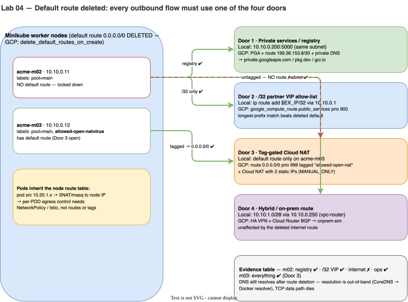

# Lab 04 · Egress Architecture: Delete the Default Route & Open the 4 Doors

> **Core Lesson:** In enterprise GCP environments, the default internet route (`0.0.0.0/0 → default-internet-gateway`) is **deleted at VPC birth**. Every outbound flow must use one of **Four Approved Doors**. Here you will prove Pod SNAT/masquerade, delete the default route on your Minikube worker nodes, and open each of the 4 Doors one by one.  
> **GCP Twin:** Phase P3 & P8 (`delete_default_routes_on_create = true`, Door 1 PGA `199.36.153.8/30`, Door 2 `vip_allowlist`, Door 3 `allowed-open-nat` + Cloud NAT, Door 4 Hybrid VPN).

---

## 1. Architecture Decision: Why Node Routes & Tags Cannot Do Per-Pod Egress Control

| Architectural Reality | Implication for Design |
|---|---|
| **Pods inherit their Node's routing table and network tags.** | When a Pod (`10.20.1.x`) sends a packet outside the cluster, the packet is **SNAT'd (masqueraded) to the Node's IP (`10.10.0.11`)** and routed by the **Node's kernel routing table**. Therefore, adding the GCP network tag `allowed-open-nat` to a node pool gives **every pod scheduled on that node** internet access at the VPC layer! |
| **How do you restrict egress per-pod if the node has a default route?** | Use **two layers**: (1) VPC Route/Tag opens the door for the node pool (e.g., Flux `source-controller` needs `gitlab.com`), and (2) **Cilium `NetworkPolicy` (L4)** or **Istio `ServiceEntry` (`REGISTRY_ONLY` L7)** restricts which specific pods on that node can exit. |
| **Why does DNS still resolve when the default internet route is deleted?** | Pod → CoreDNS (`10.30.0.10`) → Node `/etc/resolv.conf` → Docker internal DNS (`127.0.0.11` / GCP Metadata `169.254.169.254`). **DNS resolution is out-of-band from TCP routing!** A pod can resolve `example.com` to `93.184.215.14` and then immediately hang on `curl` because there is no route to `93.184.215.14`. |

---

## 2. Visual Blueprint: The 4 Outbound Doors



---

## 3. Step-by-Step Hands-On Build

### Step 1: Define the Node-Pinned Probe Helper & Resolve Target IP

```bash
# Helper: Run a one-shot curl pod pinned to a specific worker node
probe_node() {
  local node=$1; shift
  kubectl run p-$RANDOM --rm -i --restart=Never -q \
    --image=curlimages/curl --image-pull-policy=Never \
    --overrides="{\"spec\":{\"nodeSelector\":{\"kubernetes.io/hostname\":\"$node\"}}}" \
    -- -sS -m 5 -o /dev/null -w '%{http_code}\n' "$@" 2>&1 | tail -1
}

# Grab a real public IP for example.com to use as our Door 2 (/32 Partner VIP)
EX_IP=$(docker exec probe dig +short example.com A | head -n 1)
echo "Target Partner VIP for example.com: $EX_IP"
```

---

### Step 2: Prove Pod SNAT (Masquerade) Before Cutting Egress

When a Pod on `acme-m02` (`10.20.1.x`) calls `echo` (`10.10.0.201`) outside the cluster, what source IP does `echo` see in its access logs?

```bash
# 1. Baseline check with "training wheels" (default route still present)
probe_node acme-m02 https://example.com          # Expected: 200

# 2. Call the external echo server on acme-main (10.10.0.201) from a pod on acme-m02
probe_node acme-m02 http://10.10.0.201/

# 3. Inspect echo's access log:
docker logs echo --tail 3
```

**Expected Output:** The log shows **`10.10.0.11`** (the **Node IP** of `acme-m02`), **not** the Pod IP (`10.20.1.x`)!  
*Why?* Because `10.10.0.201` has no idea how to route back to `10.20.0.0/20`. Cilium SNATs (masquerades) the pod's source IP to the node's `eth0` IP when leaving the cluster.

---

### Step 3: Close the Doors (Delete the Default Route on Workers)

Now flip `training_wheels = false` by deleting `default` (`0.0.0.0/0`) on both worker nodes (`acme-m02` and `acme-m03`):

```bash
for n in acme-m02 acme-m03; do
  docker exec "$n" ip route del default || true
  echo "=== Routes on $n ==="
  docker exec "$n" ip route
done
```

Test internet access from `acme-m02` now:

```bash
# Fails with 000 / exit code 7 (No route to host / timeout)!
probe_node acme-m02 https://example.com || echo "EXPECTED: Internet egress is completely cut!"
```

---

### Step 4: Open the 4 Outbound Doors One by One

#### Door 1: Private Services / Local Registry (`10.10.0.200:5000`)
Even with `0.0.0.0/0` deleted, `10.10.0.200` is reachable on `acme-main` (just as `199.36.153.8/30` `private.googleapis.com` is reachable on GCP via Door 1):

```bash
probe_node acme-m02 http://10.10.0.200:5000/v2/
# Expected: 200! Private registry works without an internet default route!
```

#### Door 2: Exact `/32` Partner VIP Route (`$EX_IP/32`)
Suppose `acme-m02` must call **only** `example.com` (`$EX_IP/32`) and nothing else on the internet:

```bash
# Add a /32 static route on acme-m02 pointing to the gateway (10.10.0.1)
docker exec acme-m02 ip route replace "$EX_IP/32" via 10.10.0.1

# Test example.com (Works: 200!) vs google.com (Fails: blocked!)
probe_node acme-m02 --resolve "example.com:443:$EX_IP" https://example.com
probe_node acme-m02 https://www.google.com || echo "Blocked! Only the /32 VIP has a route!"
```

#### Door 3: Tag-Gated Open NAT (`allowed-open-nat=true` on `acme-m03` Only)
In Lab 02, we labeled `acme-m03` with `allowed-open-nat=true`. In GCP, a tag-scoped route `0.0.0.0/0` applies **only** to nodes with that tag:

```bash
# Restore default route ONLY on nodes labeled allowed-open-nat=true (acme-m03)
for n in $(kubectl get nodes -l allowed-open-nat=true -o jsonpath='{.items[*].metadata.name}'); do
  echo "Opening Door 3 (NAT default route) on tagged node: $n"
  docker exec "$n" ip route replace default via 10.10.0.1
done

# Compare untagged node (acme-m02) vs tagged node (acme-m03) for google.com:
probe_node acme-m02 https://www.google.com || echo "acme-m02: Blocked (No tag)"
probe_node acme-m03 https://www.google.com    # Expected: 200!
```

#### Door 4: Hybrid / On-Prem Route via `vpc-router` (`10.10.1.0/28`)
Because `scripts/routes.sh` added `10.10.1.0/28 via 10.10.0.250` on all nodes, traffic to `acme-ops` (`10.10.1.3`) uses the internal router regardless of whether `default` exists:

```bash
# Allow acme-main -> acme-ops on vpc-router and ping probe (10.10.1.3) from acme-m02
docker exec acme-m02 ping -c 2 10.10.1.3
```

---

## 4. Summary Verification Table (Your Evidence Sheet)

| Outbound Flow | Node `acme-m02` (No Default Route) | Node `acme-m03` (`allowed-open-nat=true`) | Door Used | GCP P3/P8 Twin |
|---|---|---|---|---|
| `http://10.10.0.200:5000/v2/` | `200` | `200` | **Door 1** | PGA + `199.36.153.8/30` + Private DNS |
| `https://example.com` (`$EX_IP/32`) | `200` | `200` | **Door 2** | `google_compute_route.public_services` (`/32`) |
| `https://www.google.com` (Any IP) | `000` (Dropped) | `200` | **Door 3** | Tag `allowed-open-nat` + Cloud NAT |
| `ping 10.10.1.3` (`acme-ops`) | `0% loss` | `0% loss` | **Door 4** | Cloud Router BGP + HA VPN |

---

## 5. Deliberate Break & Triage Drills

### Drill 1: The Un-Preloaded Image Pull Trap (`ImagePullBackOff`)
What happens when a pod is scheduled onto `acme-m02` (no default route) requesting an image from Docker Hub (`alpine:3.19`) that wasn't preloaded or mirrored in Door 1?

```bash
kubectl run broken-pull --image=alpine:3.19 \
  --overrides='{"spec":{"nodeSelector":{"kubernetes.io/hostname":"acme-m02"}}}' -- sleep 3600
sleep 8
kubectl get pod broken-pull
kubectl describe pod broken-pull | tail -n 8

# Clean up
kubectl delete pod broken-pull --wait=false
```
> **Lesson:** Image pulls are a **node-level egress dependency**. On GKE with `delete_default_routes_on_create = true`, pulling from `docker.io` fails with this exact `ImagePullBackOff` unless you configure **Artifact Registry Remote Repository (`dockerhub-mirror`)** over Door 1!

---

## 6. Readiness Gate G-04

1. Why did `dig example.com` succeed from a pod on `acme-m02` even after `ip route del default`, while `curl https://example.com` timed out? *(DNS queries go to CoreDNS → Docker host resolver out-of-band; TCP packets to `93.184.215.14:443` use the node's routing table and hit `No route to host`).*
2. If you only want the `flux-system/source-controller` pod to reach `gitlab.com` over Door 3, why isn't tagging the node `allowed-open-nat` enough by itself? *(The tag opens the route for the entire node; every pod on that node inherits it unless restricted by Kubernetes `NetworkPolicy` or Istio `REGISTRY_ONLY`).*

---
**Next Step:** [Lab 05 · L3/L4 Zero-Trust with Cilium NetworkPolicy & Hubble →](lab-05-l3-l4-network-policy.md)
