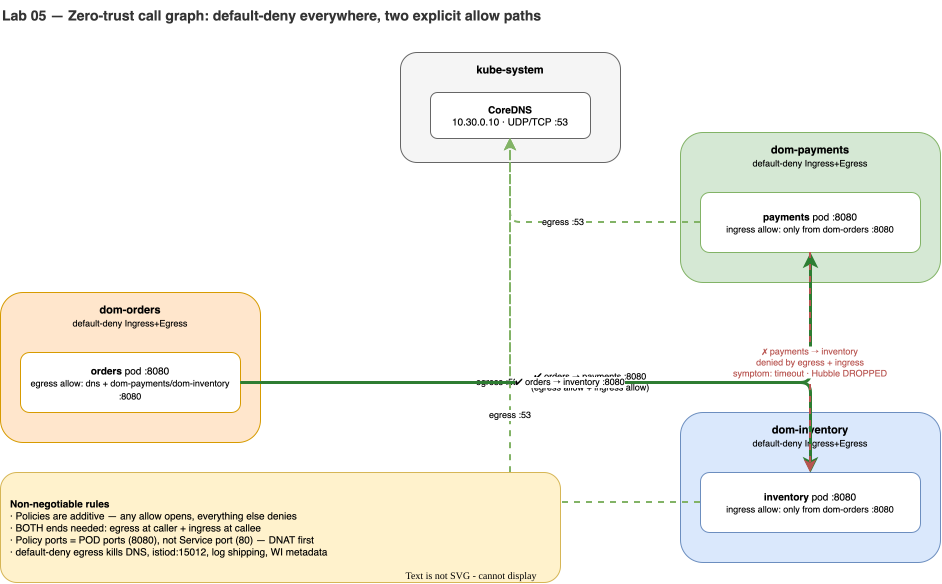

# Lab 05 · L3/L4 Zero-Trust Guard: Cilium NetworkPolicy & Hubble Verdicts

> **Core Lesson:** Lock down the flat pod network using **Default-Deny Ingress + Egress** in every domain namespace (`dom-orders`, `dom-payments`, `dom-inventory`), open only the exact holes required (DNS `53` and Pod `targetPort: 8080`), and use **Cilium Hubble** to inspect dropped packets in real time.  
> **GCP Twin:** Phase P7e (GKE Dataplane V2 `NetworkPolicy`).

---

## 1. Architecture Decision: The 4 Non-Negotiable Rules of `NetworkPolicy`

| Rule | Why It Bites Engineers in Production |
|---|---|
| **1. Policies are Additive (Union of Allows)** | Once *any* `NetworkPolicy` selects a Pod for `Ingress` or `Egress`, that direction becomes **deny-by-default** except for what is matched by the union of all policies selecting that Pod. There are no `DENY` rules in standard `NetworkPolicy`. |
| **2. Both Ends of a Call Must Agree** | For `orders` (`dom-orders`) to call `payments` (`dom-payments`), you need **two** policies: an **Egress allow** in `dom-orders` AND an **Ingress allow** in `dom-payments`. Forgetting either causes a silent timeout! |
| **3. Policy Ports Are POD Ports (`8080`), Not Service Ports (`80`)** | Cilium eBPF translates `ClusterIP:80` → `PodIP:8080` **before** evaluating `NetworkPolicy`. Writing `port: 80` in your policy drops 100% of traffic! |
| **4. Default-Deny Egress Breaks Hidden Control Loops** | Blocking all egress immediately kills **CoreDNS (`53`)**, and in later labs will kill **Istio xDS (`15012`)**, **Log Shipping (`24224`)**, and **GKE Workload Identity (`169.254.169.252:988`)**. Every platform dependency must be explicitly listed in your baseline egress policy. |

---

## 2. Visual Blueprint: Target Call Graph & Policy Matrix



---

## 3. Step-by-Step Hands-On Build

### Step 1: Apply Default-Deny + DNS Baseline to All 3 Domains

```bash
for ns in dom-orders dom-payments dom-inventory; do
kubectl apply -f - <<EOF
apiVersion: networking.k8s.io/v1
kind: NetworkPolicy
metadata:
  name: default-deny
  namespace: $ns
spec:
  podSelector: {}
  policyTypes:
    - Ingress
    - Egress
---
apiVersion: networking.k8s.io/v1
kind: NetworkPolicy
metadata:
  name: allow-dns
  namespace: $ns
spec:
  podSelector: {}
  policyTypes:
    - Egress
  egress:
    - to:
        - namespaceSelector:
            matchLabels:
              kubernetes.io/metadata.name: kube-system
      ports:
        - protocol: UDP
          port: 53
        - protocol: TCP
          port: 53
EOF
done
```

Test `orders -> payments` right now (before adding application allow rules):

```bash
call() {
  kubectl -n "$1" exec "deploy/$2" -c app -- sh -c "wget -O /dev/null -T 3 $3 2>&1 | tail -n1"
}

call dom-orders orders http://payments.dom-payments/ || echo "EXPECTED: Timed out by default-deny!"
```

---

### Step 2: Open Explicit East-West Paths (`orders → payments` & `orders → inventory`)

Notice how we specify **`port: 8080`** (the container's `targetPort`), **not** `80`:

```bash
# 1. Egress from dom-orders -> dom-payments and dom-inventory on TCP 8080
kubectl apply -f - <<'EOF'
apiVersion: networking.k8s.io/v1
kind: NetworkPolicy
metadata:
  name: orders-egress
  namespace: dom-orders
spec:
  podSelector:
    matchLabels:
      app: orders
  policyTypes:
    - Egress
  egress:
    - to:
        - namespaceSelector:
            matchExpressions:
              - key: kubernetes.io/metadata.name
                operator: In
                values: [dom-payments, dom-inventory]
      ports:
        - protocol: TCP
          port: 8080
EOF

# 2. Ingress into dom-payments and dom-inventory ONLY from dom-orders on TCP 8080
for d in payments inventory; do
kubectl apply -f - <<EOF
apiVersion: networking.k8s.io/v1
kind: NetworkPolicy
metadata:
  name: allow-from-orders
  namespace: dom-$d
spec:
  podSelector:
    matchLabels:
      app: $d
  policyTypes:
    - Ingress
  ingress:
    - from:
        - namespaceSelector:
            matchLabels:
              kubernetes.io/metadata.name: dom-orders
      ports:
        - protocol: TCP
          port: 8080
EOF
done
```

---

### Step 3: Verify the Call Matrix & Inspect Drops in Cilium Hubble

```bash
# 1. Allowed paths (Return: "remote file exists")
call dom-orders orders http://payments.dom-payments/
call dom-orders orders http://inventory.dom-inventory/

# 2. Forbidden Lateral Movement (Return: "wget: download timed out")
call dom-payments payments http://inventory.dom-inventory/ || true
call dom-inventory inventory http://payments.dom-payments/ || true

# 3. See the exact eBPF Policy Drop Verdict in Hubble!
kubectl -n kube-system exec ds/cilium -- hubble observe --verdict DROPPED --last 10
```

**Expected Hubble Output:**
```text
Oct 24 ... dom-payments/payments-xxx:41822 -> dom-inventory/inventory-xxx:8080 Policy denied DROPPED (TCP Flags: SYN)
```

---

## 4. Deliberate Break & Triage Drills

### Drill 1: DNS-Denied vs Connection-Denied (Different Error Signatures!)
How do you know in 1 second whether `default-deny` blocked **DNS (port 53)** vs **HTTP (port 8080)**?

```bash
# Delete allow-dns in dom-orders
kubectl -n dom-orders delete netpol allow-dns

# Call payments: Notice it fails INSTANTLY with "wget: bad address 'payments.dom-payments'"!
call dom-orders orders http://payments.dom-payments/ || true

# Restore allow-dns:
kubectl apply -f - <<'EOF'
apiVersion: networking.k8s.io/v1
kind: NetworkPolicy
metadata: { name: allow-dns, namespace: dom-orders }
spec:
  podSelector: {}
  policyTypes: [Egress]
  egress:
  - to: [{ namespaceSelector: { matchLabels: { kubernetes.io/metadata.name: kube-system } } }]
    ports: [{ protocol: UDP, port: 53 }, { protocol: TCP, port: 53 }]
EOF
```

### Drill 2: The Service Port (`80`) vs Pod Port (`8080`) Trap
```bash
# Change orders-egress port from 8080 -> 80
kubectl -n dom-orders patch netpol orders-egress --type='json' \
  -p='[{"op":"replace","path":"/spec/egress/0/ports/0/port","value":80}]'

# Call http://payments.dom-payments/ (which dials Service port 80!) -> FAILS with timeout!
call dom-orders orders http://payments.dom-payments/ || true

# Check Hubble: You see the packet was already DNAT'd to :8080 when Egress Policy evaluated it!
kubectl -n kube-system exec ds/cilium -- hubble observe --from-namespace dom-orders --verdict DROPPED --last 5

# Fix back to 8080:
kubectl -n dom-orders patch netpol orders-egress --type='json' \
  -p='[{"op":"replace","path":"/spec/egress/0/ports/0/port","value":8080}]'
call dom-orders orders http://payments.dom-payments/
```

---

## 5. Readiness Gate G-05

1. Compare the exact error messages of:
   - Missing `allow-dns` Egress policy → *`wget: bad address 'payments.dom-payments'`*
   - Missing `allow-from-orders` Ingress policy → *`wget: download timed out`*
   - Wrong `targetPort` on Service (with open policy) → *`wget: can't connect: Connection refused`*
2. On GCP GKE (`acme-labs-plan.md` P7e), what additional IP/port **must** be added to `allow-baseline-egress` in every namespace so pods can authenticate to Google Cloud APIs? *(`169.254.169.252/32` on TCP port `988` — the GKE Workload Identity metadata server).*

---
**Next Step:** [Lab 06 · L7 Zero-Trust Guard: Istio Sidecars, STRICT mTLS & SPIFFE AuthZ →](lab-06-l7-istio-mtls-authz.md)
