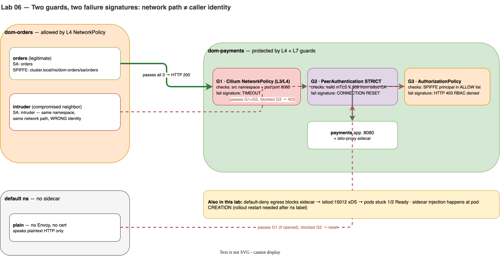
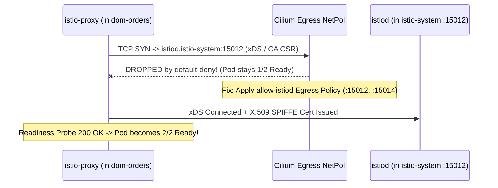

# Lab 06 · L7 Zero-Trust Guard: Istio Sidecars, STRICT mTLS & SPIFFE AuthZ

> **Core Lesson:** NetworkPolicy (L3/L4) only checks **where** a packet comes from (IP/Namespace), not **who** is calling. If a rogue pod (`intruder`) lands inside `dom-orders`, NetworkPolicy lets it call `payments` freely! Here you will add **Istio sidecar proxies (`istio-proxy`)**, fix the classic `1/2 Ready` xDS egress trap, enforce **`STRICT` mTLS**, and lock `payments` down to the cryptographic **SPIFFE identity** `cluster.local/ns/dom-orders/sa/orders`.  
> **GCP Twin:** Phase P5 & P7 (`istiod`, `PeerAuthentication`, `AuthorizationPolicy`).

---

## 1. Architecture Decision: Why Combine L4 `NetworkPolicy` AND L7 `AuthorizationPolicy`?



| Security Layer | Enforced By | What It Checks | Failure Signature |
|---|---|---|---|
| **Guard 1 (L3/L4)** | Cilium eBPF (`NetworkPolicy`) | Pod IP / Namespace label + TCP Port `8080` | **Timeout** (`wget: download timed out`) |
| **Guard 2 (L4/L7 Crypto)** | Envoy Sidecar (`PeerAuthentication: STRICT`) | Valid X.509 mTLS client certificate signed by `istiod` Citadel CA | **Connection Reset** (`Connection reset by peer` / empty reply) |
| **Guard 3 (L7 Identity)** | Envoy Sidecar (`AuthorizationPolicy`) | SAN field inside X.509 cert (`spiffe://cluster.local/ns/dom-orders/sa/orders`), HTTP verb/path | **HTTP 403** (`RBAC: access denied`) |

---

## 2. Step-by-Step Hands-On Build

### Step 1: Install Istio (Sidecar Mode) & Enable Namespace Injection

We deliberately use **Sidecar Mode** (`profile=minimal`) with JSON access logging to `stdout` (matching GKE Phase P5):

```bash
# 1. Install istiod control plane
istioctl install --set profile=minimal \
  --set meshConfig.accessLogFile=/dev/stdout \
  --set meshConfig.accessLogEncoding=JSON -y

kubectl -n istio-system rollout status deploy/istiod --timeout=180s

# 2. Label the 3 domain namespaces for automatic sidecar injection
kubectl label ns dom-orders dom-payments dom-inventory istio-injection=enabled --overwrite

# 3. Check pods BEFORE restarting deployments: Notice they are still 1/1!
kubectl get pods -n dom-orders
```

> **Nuance #1 Revealed:** Mutating Admission Webhooks run **only at Pod creation time**. Labeling a namespace does nothing to running pods until they are recreated!

Now trigger a rollout restart across the 3 domains:

```bash
for ns in dom-orders dom-payments dom-inventory; do
  kubectl -n "$ns" rollout restart deploy
done
```

---

### Step 2: Diagnose & Fix Break #1 — Pods Stuck at `1/2 Ready`!

Wait 15 seconds and inspect the pods in `dom-orders`:

```bash
kubectl -n dom-orders get pods
kubectl -n dom-orders logs deploy/orders -c istio-proxy --tail=10
```

**Why are the pods stuck at `1/2 Ready`?**  
In Lab 05, we applied `default-deny` Egress to `dom-orders`, `dom-payments`, and `dom-inventory`! The newly injected `istio-proxy` container must connect to `istiod.istio-system.svc:15012` (xDS config & certificate signing) before its readiness probe (`:15021/healthz/ready`) turns green. Cilium is dropping port `15012`!



Prove it in Hubble, then apply the `allow-istiod` Egress policy across all 3 domains:

```bash
# 1. Prove the drop in Hubble
kubectl -n kube-system exec ds/cilium -- hubble observe --to-port 15012 --verdict DROPPED --last 5

# 2. Allow egress to istio-system on TCP 15012 & 15014 in all 3 domains
for ns in dom-orders dom-payments dom-inventory; do
kubectl apply -f - <<EOF
apiVersion: networking.k8s.io/v1
kind: NetworkPolicy
metadata:
  name: allow-istiod
  namespace: $ns
spec:
  podSelector: {}
  policyTypes:
    - Egress
  egress:
    - to:
        - namespaceSelector:
            matchLabels:
              kubernetes.io/metadata.name: istio-system
      ports:
        - protocol: TCP
          port: 15012
        - protocol: TCP
          port: 15014
EOF
done

# 3. Verify all pods converge to 2/2 Ready and SYNCED in istioctl!
for ns in dom-orders dom-payments dom-inventory; do
  kubectl -n "$ns" rollout status deploy --timeout=120s
done
istioctl proxy-status
```

---

### Step 3: Enforce `STRICT` mTLS & Prove the Plaintext Rejection Signature

By default, Istio runs in `PERMISSIVE` mode (accepts both mTLS and plaintext). Let's lock `dom-payments` and `dom-inventory` to **`STRICT` mTLS**:

```bash
for ns in dom-orders dom-payments dom-inventory; do
kubectl apply -f - <<EOF
apiVersion: security.istio.io/v1
kind: PeerAuthentication
metadata:
  name: default
  namespace: $ns
spec:
  mtls:
    mode: STRICT
EOF
done
```

Now test what happens when a **non-mesh plaintext pod** (in the `default` namespace) is allowed through the L4 `NetworkPolicy` and tries to call `payments`:

```bash
# 1. Temporarily open an L4 NetworkPolicy hole from 'default' namespace -> dom-payments:8080
kubectl apply -f - <<'EOF'
apiVersion: networking.k8s.io/v1
kind: NetworkPolicy
metadata: { name: tmp-allow-default, namespace: dom-payments }
spec:
  podSelector: {}
  policyTypes: [Ingress]
  ingress:
  - from: [{ namespaceSelector: { matchLabels: { kubernetes.io/metadata.name: default } } }]
    ports: [{ protocol: TCP, port: 8080 }]
EOF

# 2. Call payments from an un-meshed pod in 'default':
#    Observe the signature: "curl: (56) Recv failure: Connection reset by peer"
kubectl run plain-caller --rm -i --restart=Never --image=curlimages/curl --image-pull-policy=Never -- \
  -sS -m 4 http://payments.dom-payments/ || echo "EXPECTED: Connection reset by STRICT mTLS!"

# 3. Remove the temporary L4 hole
kubectl -n dom-payments delete netpol tmp-allow-default
```

---

### Step 4: Enforce L7 SPIFFE `AuthorizationPolicy` (Stop the Same-Namespace Intruder)

Now deploy an `intruder` pod **inside `dom-orders`** using `ServiceAccount: intruder`. Because `intruder` is inside `dom-orders` and has a valid Istio sidecar, it passes **both** Guard 1 (`NetworkPolicy`) and Guard 2 (`STRICT` mTLS)!

```bash
# 1. Deploy 'intruder' inside dom-orders
kubectl apply -f - <<'EOF'
apiVersion: v1
kind: ServiceAccount
metadata: { name: intruder, namespace: dom-orders }
---
apiVersion: apps/v1
kind: Deployment
metadata: { name: intruder, namespace: dom-orders }
spec:
  replicas: 1
  selector: { matchLabels: { app: intruder } }
  template:
    metadata: { labels: { app: intruder } }
    spec:
      serviceAccountName: intruder
      containers:
      - name: app
        image: nginxinc/nginx-unprivileged:alpine
        imagePullPolicy: IfNotPresent
EOF

# Also allow intruder pod in dom-orders to egress to dom-payments:8080 at L4 so we test L7 alone
kubectl -n dom-orders patch netpol orders-egress -p '{"spec":{"podSelector":{}}}'
kubectl -n dom-orders rollout status deploy/intruder --timeout=90s

# 2. Apply L7 AuthorizationPolicy on dom-payments and dom-inventory:
#    ONLY allow SPIFFE principal "cluster.local/ns/dom-orders/sa/orders"
for d in payments inventory; do
kubectl apply -f - <<EOF
apiVersion: security.istio.io/v1
kind: AuthorizationPolicy
metadata:
  name: only-orders-sa
  namespace: dom-$d
spec:
  action: ALLOW
  rules:
    - from:
        - source:
            principals:
              - "cluster.local/ns/dom-orders/sa/orders"
EOF
done
```

Now run the side-by-side comparison from `orders` vs `intruder` (both in `dom-orders`):

```bash
call() {
  kubectl -n "$1" exec "deploy/$2" -c app -- sh -c "wget -O - -T 3 $3 2>&1 | grep -E 'HTTP/|RBAC|remote'"
}

# 1. Legitimate caller (SA: orders) -> HTTP/1.1 200 OK
call dom-orders orders http://payments.dom-payments/

# 2. Compromised neighbor in SAME namespace (SA: intruder) -> HTTP/1.1 403 Forbidden (RBAC: access denied)
call dom-orders intruder http://payments.dom-payments/ || true
```

Inspect the Envoy access log on `payments` to see the cryptographic `peer_principal`:

```bash
kubectl -n dom-payments logs deploy/payments -c istio-proxy --tail=5
```

Clean up the `intruder` test workload:
```bash
kubectl -n dom-orders delete deploy/intruder sa/intruder
```

---

## 3. Readiness Gate G-06

Without running any commands, name the exact layer and root cause for each output:
1. `wget: download timed out` → **Layer 4 `NetworkPolicy` (Cilium eBPF dropped the SYN packet).**
2. `curl: (56) Recv failure: Connection reset by peer` → **Layer 7 `PeerAuthentication: STRICT` (Caller sent plaintext instead of mTLS).**
3. `HTTP/1.1 403 Forbidden` / `RBAC: access denied` → **Layer 7 `AuthorizationPolicy` (Valid mTLS cert, but caller's SPIFFE ServiceAccount is not in `principals`).**

---
**Next Step:** [Lab 07 · 4-Container Pod & Central Observability Pipeline →](lab-07-sidecars-central-logging.md)
