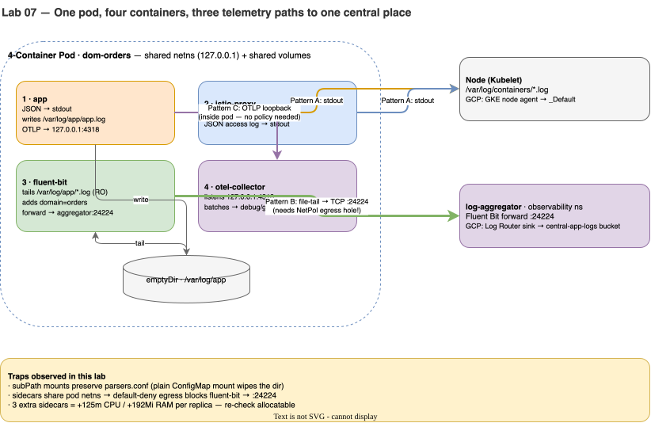

# Lab 07 · The 4-Container Pod & Central Observability Pipeline

> **Core Lesson:** Upgrade your reusable Tier-2 Helm chart (`acme-microservice`) so every domain pod runs **4 containers** (`app` + `istio-proxy` + `fluent-bit` + `otel-collector`), prove all three enterprise telemetry patterns (`stdout`, shared `emptyDir` file-tailing, and loopback OTLP), and solve the `subPath` mount + Default-Deny Egress traps.  
> **GCP Twin:** Phase P6 & P7a (`google_logging_project_bucket_config.central`, `google_logging_project_sink.domains`, `stackdriver` & `googlecloud` exporters).

---

## 1. Architecture Decision: Why Do Enterprises Use 3 Telemetry Paths?



| Nuance | What Happens If You Get It Wrong |
|---|---|
| **`subPath: fluent-bit.conf` on ConfigMap Volume Mounts** | Inside `fluent/fluent-bit:3.2`, `/fluent-bit/etc/` already contains `parsers.conf`. If you mount a ConfigMap onto `/fluent-bit/etc` **without `subPath`**, Kubernetes hides the entire directory, deleting `parsers.conf` and crashing the pod! |
| **Sidecar Resource Multiplication Tax** | Adding 3 sidecars per pod (`istio-proxy` 50m/96Mi + `otel-collector` 50m/64Mi + `fluent-bit` 25m/32Mi) adds **125m CPU and 192Mi RAM to every single replica**. Always calculate node allocatable capacity before enabling sidecars cluster-wide. |
| **Sidecars Share the Pod's Network Namespace & `NetworkPolicy`** | Loopback calls (`app -> 127.0.0.1:4318` `otel-collector`) never leave the pod and need no `NetworkPolicy`. Calling `log-aggregator.observability:24224` leaves the pod and **is blocked by `default-deny` egress** until explicitly allowed! |

---

## 2. Step-by-Step Hands-On Build

### Step 1: Deploy the Central Log Aggregator in `observability` (Cloud Logging Bucket Twin)

```bash
kubectl apply -f - <<'EOF'
apiVersion: v1
kind: ConfigMap
metadata:
  name: aggregator-config
  namespace: observability
data:
  fluent-bit.conf: |
    [SERVICE]
        Flush        1
        Log_Level    info
    [INPUT]
        Name         forward
        Listen       0.0.0.0
        Port         24224
    [OUTPUT]
        Name         stdout
        Match        *
        Format       json_lines
---
apiVersion: apps/v1
kind: Deployment
metadata:
  name: log-aggregator
  namespace: observability
spec:
  replicas: 1
  selector:
    matchLabels:
      app: log-aggregator
  template:
    metadata:
      labels:
        app: log-aggregator
    spec:
      containers:
        - name: fluent-bit
          image: fluent/fluent-bit:3.2
          imagePullPolicy: IfNotPresent
          ports:
            - containerPort: 24224
          volumeMounts:
            - name: cfg
              mountPath: /fluent-bit/etc/fluent-bit.conf
              subPath: fluent-bit.conf
      volumes:
        - name: cfg
          configMap:
            name: aggregator-config
---
apiVersion: v1
kind: Service
metadata:
  name: log-aggregator
  namespace: observability
spec:
  selector:
    app: log-aggregator
  ports:
    - name: tcp-forward
      port: 24224
      targetPort: 24224
EOF

kubectl -n observability rollout status deploy/log-aggregator --timeout=90s
```

---

### Step 2: Upgrade Your Reusable Helm Chart (`charts/acme-microservice`) for 4 Containers

Update `charts/acme-microservice/templates/all.yaml` so setting `sidecars.fluentbit.enabled=true` and `sidecars.otel.enabled=true` injects the ConfigMaps, `emptyDir` volume, and both sidecars:

```bash
cat << 'EOF' > ~/acme-k8s-lab/charts/acme-microservice/templates/all.yaml
apiVersion: v1
kind: ServiceAccount
metadata:
  name: {{ .Values.domain }}
  namespace: dom-{{ .Values.domain }}
  {{- if .Values.serviceAccount.gsaEmail }}
  annotations:
    iam.gke.io/gcp-service-account: {{ .Values.serviceAccount.gsaEmail | quote }}
  {{- end }}
---
{{- if .Values.sidecars.fluentbit.enabled }}
apiVersion: v1
kind: ConfigMap
metadata:
  name: {{ .Values.domain }}-fluentbit
  namespace: dom-{{ .Values.domain }}
data:
  fluent-bit.conf: |
    [SERVICE]
        Flush        1
        Parsers_File parsers.conf
    [INPUT]
        Name         tail
        Path         /var/log/app/*.log
         Tag          app.{{ .Values.domain }}
    [FILTER]
        Name         record_modifier
        Match        *
        Record       domain {{ .Values.domain }}
    [OUTPUT]
        Name         forward
        Match        *
        Host         log-aggregator.observability.svc.cluster.local
        Port         24224
---
{{- end }}
{{- if .Values.sidecars.otel.enabled }}
apiVersion: v1
kind: ConfigMap
metadata:
  name: {{ .Values.domain }}-otel
  namespace: dom-{{ .Values.domain }}
data:
  config.yaml: |
    receivers:
      otlp:
        protocols:
          http:
            endpoint: 127.0.0.1:4318
    exporters:
      debug:
        verbosity: basic
    service:
      pipelines:
        traces:
          receivers: [otlp]
          exporters: [debug]
---
{{- end }}
apiVersion: v1
kind: Service
metadata:
  name: {{ .Values.domain }}
  namespace: dom-{{ .Values.domain }}
  labels:
    app: {{ .Values.domain }}
    domain: {{ .Values.domain }}
spec:
  selector:
    app: {{ .Values.domain }}
  ports:
    - name: http
      port: {{ .Values.service.port }}
      targetPort: {{ .Values.service.targetPort }}
---
apiVersion: apps/v1
kind: Deployment
metadata:
  name: {{ .Values.domain }}
  namespace: dom-{{ .Values.domain }}
spec:
  replicas: {{ .Values.replicas }}
  selector:
    matchLabels:
      app: {{ .Values.domain }}
  template:
    metadata:
      labels:
        app: {{ .Values.domain }}
        domain: {{ .Values.domain }}
    spec:
      serviceAccountName: {{ .Values.domain }}
      volumes:
        - name: applogs
          emptyDir: {}
        {{- if .Values.sidecars.fluentbit.enabled }}
        - name: fb-cfg
          configMap:
            name: {{ .Values.domain }}-fluentbit
        {{- end }}
        {{- if .Values.sidecars.otel.enabled }}
        - name: otel-cfg
          configMap:
            name: {{ .Values.domain }}-otel
        {{- end }}
      containers:
        - name: app
          image: "{{ .Values.image.repository }}:{{ .Values.image.tag }}"
          imagePullPolicy: {{ .Values.image.pullPolicy }}
          ports:
            - containerPort: {{ .Values.service.targetPort }}
          # Tee nginx access logs to BOTH stdout (Pattern A) and /var/log/app/access.log (Pattern B)
          lifecycle:
            postStart:
              exec:
                command:
                  - /bin/sh
                  - -c
                  - |
                    touch /var/log/app/app.log
                    (while true; do
                      echo "{\"severity\":\"INFO\",\"domain\":\"{{ .Values.domain }}\",\"message\":\"heartbeat\"}" >> /var/log/app/app.log
                      wget -qO /dev/null --header="Content-Type: application/json" \
                        --post-data='{"resourceSpans":[{"resource":{"attributes":[{"key":"service.name","value":{"stringValue":"{{ .Values.domain }}"}}]},"scopeSpans":[{"spans":[{"traceId":"5B8EFFF798038103D269B633813FC60C","spanId":"EEE19B7EC3C1B174","name":"heartbeat","startTimeUnixNano":"1700000000000000000","endTimeUnixNano":"1700000001000000000","kind":1}]}]}]}' \
                        http://127.0.0.1:4318/v1/traces 2>/dev/null || true
                      sleep 5
                    done) &
          volumeMounts:
            - name: applogs
              mountPath: /var/log/app
          resources:
            {{- toYaml .Values.resources | nindent 12 }}
        {{- if .Values.sidecars.fluentbit.enabled }}
        - name: fluent-bit
          image: {{ .Values.sidecars.fluentbit.image }}
          imagePullPolicy: IfNotPresent
          volumeMounts:
            - name: applogs
              mountPath: /var/log/app
              readOnly: true
            - name: fb-cfg
              mountPath: /fluent-bit/etc/fluent-bit.conf
              subPath: fluent-bit.conf
          resources:
            requests:
              cpu: 25m
              memory: 32Mi
            limits:
              memory: 64Mi
        {{- end }}
        {{- if .Values.sidecars.otel.enabled }}
        - name: otel-collector
          image: {{ .Values.sidecars.otel.image }}
          imagePullPolicy: IfNotPresent
          args: ["--config=/conf/config.yaml"]
          volumeMounts:
            - name: otel-cfg
              mountPath: /conf
          resources:
            requests:
              cpu: 50m
              memory: 64Mi
            limits:
              memory: 128Mi
        {{- end }}
EOF

helm lint ~/acme-k8s-lab/charts/acme-microservice
```

---

### Step 3: Upgrade All 3 Domains with Sidecars Enabled (`4/4 Ready`)

```bash
for d in orders payments inventory; do
  helm upgrade --install "$d" ~/acme-k8s-lab/charts/acme-microservice \
    --namespace "dom-$d" \
    --set domain="$d" \
    --set sidecars.fluentbit.enabled=true \
    --set sidecars.otel.enabled=true
done

# Wait for rollout and verify all 4 containers are inside each pod!
for d in orders payments inventory; do
  kubectl -n "dom-$d" rollout status "deploy/$d" --timeout=120s
  echo "=== Containers in dom-$d ==="
  kubectl -n "dom-$d" get pod -l "app=$d" -o jsonpath='{.items[0].spec.containers[*].name}{"\n"}'
done
```

**Expected Output:** `app fluent-bit otel-collector istio-proxy` (`4/4 Ready`).

---

### Step 4: Diagnose & Fix Break #2 — Central Aggregator Receives Zero Logs!

Check the central `log-aggregator` logs right now, and check `fluent-bit` inside `dom-orders`:

```bash
kubectl -n observability logs deploy/log-aggregator --tail=10
kubectl -n dom-orders logs deploy/orders -c fluent-bit --tail=5
```

**Why is `fluent-bit` failing to connect to `log-aggregator.observability:24224`?**  
Because `default-deny` Egress in `dom-orders`, `dom-payments`, and `dom-inventory` blocks TCP `24224` to `observability`! Open the Egress hole in all 3 domains:

```bash
for ns in dom-orders dom-payments dom-inventory; do
kubectl apply -f - <<EOF
apiVersion: networking.k8s.io/v1
kind: NetworkPolicy
metadata:
  name: allow-to-observability
  namespace: $ns
spec:
  podSelector: {}
  policyTypes:
    - Egress
  egress:
    - to:
        - namespaceSelector:
            matchLabels:
              kubernetes.io/metadata.name: observability
      ports:
        - protocol: TCP
          port: 24224
EOF
done
```

---

### Step 5: Verify All 3 Telemetry Streams Live

```bash
# 1. Generate a live East-West call (orders -> payments)
kubectl -n dom-orders exec deploy/orders -c app -- wget -qO /dev/null http://payments.dom-payments/

# 2. Pattern A: Node stdout logs (App + Envoy JSON access log)
kubectl -n dom-payments logs deploy/payments -c istio-proxy --tail=3

# 3. Pattern B: File-Tail Sidecar -> Central Log Aggregator (Filtered by domain!)
kubectl -n observability logs deploy/log-aggregator --tail=10

# 4. Pattern C: Loopback OTLP -> OTel Collector Sidecar
kubectl -n dom-orders logs deploy/orders -c otel-collector --tail=10
```

---

## 3. Readiness Gate G-07

1. Which of the 3 telemetry paths (`stdout`, `fluent-bit` file-tail, `otel-collector` OTLP) works even if the pod's `NetworkPolicy` blocks all egress, and why? *(`stdout` → Node Kubelet writes `/var/log/containers` on the host filesystem, and the node-level logging agent ships it using the Node's network/identity).*
2. Why did `app -> otel-collector` (`127.0.0.1:4318`) work before we added `allow-to-observability`, while `fluent-bit -> log-aggregator` (`24224`) failed? *(Containers in the same Pod share the loopback `lo` interface; `NetworkPolicy` only filters traffic entering or leaving the Pod's `eth0` veth interface).*

---
**Next Step:** [Lab 08 · North-South Entry: MetalLB LoadBalancer & The 4-Layer Ingress Gauntlet →](lab-08-ingress-metallb-gateway.md)
