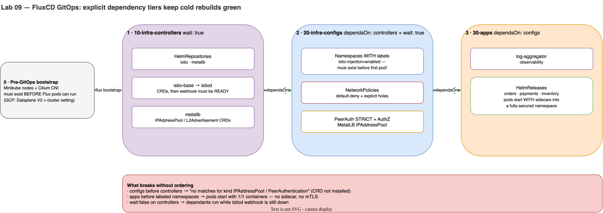

# Lab 09 · GitOps Ordering with FluxCD: Controllers → Configs → Apps

> **Core Lesson:** Replace manual `kubectl apply` and `helm upgrade` commands with a single **FluxCD GitOps repository** structured into three strict dependency tiers (`10-infra-controllers` → `20-infra-configs` → `30-apps`). Prove why removing `dependsOn` or `wait: true` causes the two classic GitOps race conditions: **CRD-before-CR failure** and **missing Istio sidecars**.  
> **GCP Twin:** Phase P5 (`flux-releases` repository, `clusters/np`).

---

## 1. Architecture Decision: Why Order Matters in GitOps

If you dump all your Kubernetes YAMLs into a single folder and point Flux or ArgoCD at it, **a cold cluster rebuild will fail every time**:



| Object | Which Tier Owns It? | What Breaks If It Runs Out of Order? |
|---|---|---|
| **Cilium CNI** | **0 · Cluster Bootstrap** (Outside Flux; GKE Dataplane V2 setting) | Flux controller pods themselves cannot schedule or pull Git repos without a working CNI! |
| **`istio-base`, `istiod`, `metallb`** | **1 · `10-infra-controllers`** (`wait: true`) | If Tier 2 runs before Tier 1 finishes, `PeerAuthentication` and `IPAddressPool` fail with `no matches for kind ... (CRD not installed)`. |
| **Labeled Namespaces (`istio-injection: enabled`), `NetworkPolicy`, `PeerAuthentication`, `AuthorizationPolicy`** | **2 · `20-infra-configs`** (`dependsOn: infra-controllers`, `wait: true`) | If Tier 3 runs before `istiod` webhook is ready OR before the Namespace has `istio-injection: enabled`, **application pods start with `1/1` containers (no Envoy sidecar, zero mTLS)!** |
| **Application `HelmRelease`s (`orders`, `payments`, `inventory`)** | **3 · `30-apps`** (`dependsOn: infra-configs`) | Lands last into a fully wired, default-deny, mTLS-enforced namespace. |

---

## 2. Step-by-Step Hands-On Build

### Step 1: Create the Local GitOps Repository Structure (`~/acme-k8s-lab/gitops`)

You can run this either against **GitLab.com** (`flux bootstrap gitlab ...`) or **100% locally offline** using a local Git repository served inside the cluster (or `flux create source git`). Below we build the exact directory layout used in GCP Phase P5:

```bash
mkdir -p ~/acme-k8s-lab/gitops/{clusters/local,infrastructure/controllers,infrastructure/configs,apps/local}
cd ~/acme-k8s-lab/gitops
```

---

### Step 2: Author the 3 Flux `Kustomization` Dependency Tiers (`clusters/local/`)

```bash
cat << 'EOF' > ~/acme-k8s-lab/gitops/clusters/local/10-infra-controllers.yaml
apiVersion: kustomize.toolkit.fluxcd.io/v1
kind: Kustomization
metadata:
  name: infra-controllers
  namespace: flux-system
spec:
  interval: 5m
  path: ./infrastructure/controllers
  prune: true
  wait: true
  timeout: 5m
  sourceRef:
    kind: GitRepository
    name: flux-system
EOF

cat << 'EOF' > ~/acme-k8s-lab/gitops/clusters/local/20-infra-configs.yaml
apiVersion: kustomize.toolkit.fluxcd.io/v1
kind: Kustomization
metadata:
  name: infra-configs
  namespace: flux-system
spec:
  interval: 5m
  dependsOn:
    - name: infra-controllers
  path: ./infrastructure/configs
  prune: true
  wait: true
  timeout: 3m
  sourceRef:
    kind: GitRepository
    name: flux-system
EOF

cat << 'EOF' > ~/acme-k8s-lab/gitops/clusters/local/30-apps.yaml
apiVersion: kustomize.toolkit.fluxcd.io/v1
kind: Kustomization
metadata:
  name: apps
  namespace: flux-system
spec:
  interval: 5m
  dependsOn:
    - name: infra-configs
  path: ./apps/local
  prune: true
  wait: true
  timeout: 5m
  sourceRef:
    kind: GitRepository
    name: flux-system
EOF
```

---

### Step 3: Populate `infrastructure/controllers/`, `infrastructure/configs/`, and `apps/local/`

#### 1. `infrastructure/controllers/istio.yaml`
```bash
cat << 'EOF' > ~/acme-k8s-lab/gitops/infrastructure/controllers/istio.yaml
apiVersion: v1
kind: Namespace
metadata:
  name: istio-system
---
apiVersion: source.toolkit.fluxcd.io/v1
kind: HelmRepository
metadata:
  name: istio
  namespace: flux-system
spec:
  interval: 1h
  url: https://istio-release.storage.googleapis.com/charts
---
apiVersion: helm.toolkit.fluxcd.io/v2
kind: HelmRelease
metadata:
  name: istio-base
  namespace: flux-system
spec:
  interval: 10m
  targetNamespace: istio-system
  chart:
    spec:
      chart: base
      sourceRef:
        kind: HelmRepository
        name: istio
        namespace: flux-system
---
apiVersion: helm.toolkit.fluxcd.io/v2
kind: HelmRelease
metadata:
  name: istiod
  namespace: flux-system
spec:
  interval: 10m
  targetNamespace: istio-system
  dependsOn:
    - name: istio-base
  chart:
    spec:
      chart: istiod
      sourceRef:
        kind: HelmRepository
        name: istio
        namespace: flux-system
  values:
    meshConfig:
      accessLogFile: /dev/stdout
      accessLogEncoding: JSON
EOF
```

#### 2. `infrastructure/configs/namespaces-and-policies.yaml`
```bash
cat << 'EOF' > ~/acme-k8s-lab/gitops/infrastructure/configs/namespaces-and-policies.yaml
apiVersion: v1
kind: Namespace
metadata:
  name: observability
---
apiVersion: v1
kind: Namespace
metadata:
  name: dom-orders
  labels:
    istio-injection: enabled
---
apiVersion: v1
kind: Namespace
metadata:
  name: dom-payments
  labels:
    istio-injection: enabled
---
apiVersion: v1
kind: Namespace
metadata:
  name: dom-inventory
  labels:
    istio-injection: enabled
---
apiVersion: metallb.io/v1beta1
kind: IPAddressPool
metadata:
  name: acme-internal-pool
  namespace: metallb-system
spec:
  addresses:
    - 10.10.0.240-10.10.0.249
---
apiVersion: metallb.io/v1beta1
kind: L2Advertisement
metadata:
  name: acme-l2
  namespace: metallb-system
spec:
  ipAddressPools:
    - acme-internal-pool
---
apiVersion: security.istio.io/v1
kind: PeerAuthentication
metadata:
  name: default
  namespace: dom-payments
spec:
  mtls:
    mode: STRICT
---
apiVersion: security.istio.io/v1
kind: AuthorizationPolicy
metadata:
  name: only-orders-sa
  namespace: dom-payments
spec:
  action: ALLOW
  rules:
    - from:
        - source:
            principals: ["cluster.local/ns/dom-orders/sa/orders"]
    - from:
        - source:
            ipBlocks: ["10.10.1.0/28"]
EOF
```

---

### Step 4: Bootstrap FluxCD & Watch Ordered Reconciliation

Ensure your cluster can reach GitLab (remember Lab 04: `acme-m03` has the `allowed-open-nat=true` default route, or restore default route on nodes for bootstrap):

```bash
# Install Flux controllers (or use `flux bootstrap gitlab ...` with your GITLAB_TOKEN)
flux install

# Verify Flux controllers are Ready
flux check
```

 If bootstrapping with GitLab (recommended for GCP P5 parity):
```bash
export GITLAB_TOKEN="<your-gitlab-pat>"
flux bootstrap gitlab \
  --hostname=gitlab.com \
  --owner="acme-labs-<handle>/domain-shared/configurations" \
  --repository=flux-releases-local \
  --branch=main \
  --path=clusters/local \
  --token-auth

# Watch the dependency chain converge in order:
flux get kustomizations -w
```

---

## 3. Deliberate Break & Triage Drills (The Point of This Lab!)

### Drill 1: Remove `dependsOn` → Trigger the "CRD Not Found" Race Condition
If you remove `dependsOn: [{name: infra-controllers}]` from `20-infra-configs.yaml` on a fresh cluster before `istio-base` or `metallb` finishes installing CRDs, what happens?
* **Exact Error in `flux get kustomizations`:**  
  `dry-run failed: no matches for kind "IPAddressPool" in version "metallb.io/v1beta1"` or `no matches for kind "PeerAuthentication" in version "security.istio.io/v1"`.
* **Why Flux Self-Heals vs Why `dependsOn` Is Still Better:** Flux will retry on its `interval`, but without `dependsOn`, workloads may deploy **before** `PeerAuthentication` or `NetworkPolicy` lands—leaving a security window open during cluster creation!

### Drill 2: Test Live Drift Correction (`prune: true` & Reconciliation)
```bash
# Manually tamper with a Flux-managed object in the cluster:
kubectl label ns dom-orders tampered=true

# Force Flux reconciliation and verify state management:
flux reconcile kustomization infra-configs --with-source
flux tree kustomization infra-configs
```

---

## 4. Readiness Gate G-09

1. Why must **Cilium CNI** be installed *before* `flux bootstrap`, rather than inside `10-infra-controllers`? *(Flux's own pods (`source-controller`, `kustomize-controller`, `helm-controller`) are normal Kubernetes Pods that require Pod IPs and DNS/egress networking to clone the Git repository).*
2. What happens if `wait: true` is omitted on `10-infra-controllers` even when `20-infra-configs` has `dependsOn: [{name: infra-controllers}]`? *(Without `wait: true`, Flux marks `infra-controllers` Ready the instant the `HelmRelease` YAML is accepted by the API server—**before** `istiod`'s webhook pod actually starts running!)*

---
**Next Step:** [Lab 10 · Disposable Cluster Cold-Rebuild & GKE Production Handoff →](lab-10-cold-rebuild-gke-handoff.md)
