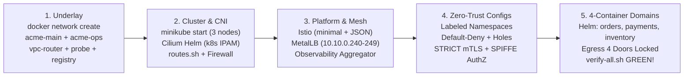
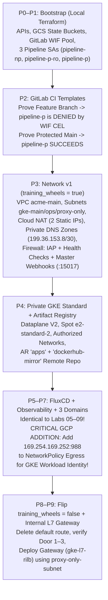

# Lab 10 · Disposable Cluster Cold-Rebuild & GCP GKE Production Handoff

> **Core Lesson:** A real platform engineer treats the cluster as **cattle, not a pet**. Here you will assemble a single automated rebuild & verification suite (`cluster-up.sh` + `verify-all.sh`) that destroys and rebuilds the entire 7-layer stack from scratch, then transitions directly into your GCP Terraform stack (`acme-labs-plan.md`).

---

## 1. Visual Blueprint: The Automated Cold-Rebuild Pipeline



---

## 2. The Automated Verification Script (`scripts/verify-all.sh`)

Save this script to validate **every layer** of your platform in 15 seconds. Whenever you change a route, firewall rule, `NetworkPolicy`, or Istio policy, run `~/acme-k8s-lab/scripts/verify-all.sh` to ensure zero regressions:

```bash
cat << 'EOF' > ~/acme-k8s-lab/scripts/verify-all.sh
#!/usr/bin/env bash
set -euo pipefail

PASS=0; FAIL=0
check() {
  local name="$1"; shift
  if eval "$@" >/dev/null 2>&1; then
    printf "  [PASS] %s\n" "$name"
    PASS=$((PASS + 1))
  else
    printf "  [FAIL] %s\n" "$name"
    FAIL=$((FAIL + 1))
  fi
}

echo "=========================================================="
echo " Acme Labs 7-Layer Platform Verification Suite"
echo "=========================================================="

echo "--- Layer 1 & 2: Underlay, IPAM & Cilium CNI ---"
check "Docker network acme-main (10.10.0.0/24) exists" \
  "docker network inspect acme-main | grep -q '10.10.0.0/24'"
check "Docker network acme-ops (10.10.1.0/28) exists" \
  "docker network inspect acme-ops | grep -q '10.10.1.0/28'"
check "All 3 Minikube nodes are Ready" \
  "[ \$(kubectl get nodes --no-headers | grep -c ' Ready') -eq 3 ]"
check "Nodes allocated Pod CIDRs from 10.20.0.0/20" \
  "kubectl get node acme -o jsonpath='{.spec.podCIDR}' | grep -q '^10\.20\.'"
check "Service kubernetes.default is 10.30.0.1" \
  "[ \"\$(kubectl get svc kubernetes -o jsonpath='{.spec.clusterIP}')\" = '10.30.0.1' ]"
check "probe (10.10.1.3) reaches Control Plane API :8443 via vpc-router" \
  "docker exec probe curl -sk -m 3 https://10.10.0.10:8443/version"

echo "--- Layer 3 & 4: Workloads & L3/L4 Cilium NetworkPolicy ---"
call_svc() {
  kubectl -n "$1" exec "deploy/$2" -c app -- sh -c "wget -qO /dev/null -T 3 $3"
}
check "Allowed East-West: orders -> payments (200 OK)" \
  "call_svc dom-orders orders http://payments.dom-payments/"
check "Allowed East-West: orders -> inventory (200 OK)" \
  "call_svc dom-orders orders http://inventory.dom-inventory/"
check "Blocked Lateral Movement: payments -> inventory (Dropped)" \
  "! call_svc dom-payments payments http://inventory.dom-inventory/"

echo "--- Layer 5 & 6: Istio Sidecars, 4-Container Pod & Ingress ---"
check "orders pod has all 4 containers (app, fluent-bit, otel-collector, istio-proxy)" \
  "[ \$(kubectl -n dom-orders get pod -l app=orders -o jsonpath='{.items[0].spec.containers[*].name}' | wc -w) -eq 4 ]"
check "Central log-aggregator in observability is receiving domain logs" \
  "kubectl -n observability logs deploy/log-aggregator --tail=50 | grep -q 'orders'"
LB_IP=$(kubectl -n dom-payments get svc payments-lb -o jsonpath='{.status.loadBalancer.ingress[0].ip}' 2>/dev/null || true)
check "North-South Ingress: probe (10.10.1.3) -> payments-lb ($LB_IP) returns 200" \
  "[ -n \"$LB_IP\" ] && [ \"\$(docker exec probe curl -s -m 3 -o /dev/null -w '%{http_code}' http://$LB_IP/)\" = '200' ]"

echo "=========================================================="
printf " Summary: %d PASSED, %d FAILED\n" "$PASS" "$FAIL"
echo "=========================================================="
[ "$FAIL" -eq 0 ]
EOF
chmod +x ~/acme-k8s-lab/scripts/verify-all.sh
```

Run it now:
```bash
~/acme-k8s-lab/scripts/verify-all.sh
```

---

## 3. Clean Teardown Script (`scripts/cluster-down.sh`)

When you finish a session or want to test a cold rebuild from zero:

```bash
cat << 'EOF' > ~/acme-k8s-lab/scripts/cluster-down.sh
#!/usr/bin/env bash
set -euo pipefail

echo "[*] Tearing down Minikube cluster 'acme' and underlay containers..."
minikube delete -p acme || true
docker rm -f vpc-router probe registry echo 2>/dev/null || true
docker network rm acme-ops acme-main 2>/dev/null || true
echo "[✓] Clean slate ready."
EOF
chmod +x ~/acme-k8s-lab/scripts/cluster-down.sh
```

---

## 4. Your GCP GKE Handoff Checklist (Moving to `acme-labs-plan.md`)

You have now built, broken, and repaired the entire platform stack locally. When you execute **Phases P0–P9** on GCP in [`acme-labs-plan.md`](../planning/acme-labs-plan.md), follow this exact execution sequence and watch for the 5 cloud-only deltas:



### Final Self-Test Before Starting GCP Terraform
Verify you can answer all 5 GCP transition questions:
1. **Why does `platform/network` create a firewall rule from `10.10.250.0/28` to worker nodes on TCP `15017`?** *(On a private GKE cluster, `kube-apiserver` lives in Google's peered `/28` VPC and must dial the `istiod` MutatingAdmissionWebhook pod running on your worker nodes on port `15017` whenever a pod is created).*
2. **Why do `fluent-bit` and `otel-collector` silently stop shipping logs to Cloud Logging when you apply `default-deny` Egress on GKE unless you allow `169.254.169.252:988`?** *(GKE Workload Identity intercepts metadata requests on `169.254.169.252:988` to mint GCP OAuth access tokens for the pod's GSA; blocking egress to that IP prevents the sidecars from authenticating to Google APIs).*
3. **Why does Cloud NAT require `source_ip_ranges_to_nat = ["ALL_IP_RANGES"]` on `gke-main`?** *(On VPC-Native GKE, pods use secondary alias IP ranges (`10.20.0.0/20`) that are NOT masqueraded to the node IP inside the VPC; if Cloud NAT only NATs the primary node range (`10.10.0.0/24`), pods have no internet egress through Door 3).*
4. **Why do we point `istiod` and sidecar images to `us-central1-docker.pkg.dev/.../dockerhub-mirror/...` before flipping `training_wheels = false` in P8?** *(Once the default internet route is deleted, untagged nodes cannot reach Docker Hub (`docker.io`), whereas Artifact Registry resolves to `199.36.153.8/30` via Door 1 Private Google Access).*
5. **Why does `gke-l7-rilb` require `proxy-only-subnet` (`10.10.254.0/23`) and a firewall rule from `10.10.254.0/23` to `gke-node`?** *(Google's regional internal Envoy fleet terminates the client connection inside `10.10.254.0/23` and opens a new backend connection from `10.10.254.x` to your GKE Pod IPs on `:8080`).*
6. **A GCP Load Balancer returns `502 Bad Gateway` — why is that usually a health-check/firewall issue, not an app bug?** *(Google LBs health-check each backend from `130.211.0.0/22` and `35.191.0.0/16`; if those ranges (or the readiness probe path/port) are blocked by VPC firewall or NetworkPolicy, backends are marked unhealthy and the LB returns 502 even while the app is running fine. On GKE, backends are NEGs — pods get health-checked directly).*
7. **A pod needs to call Cloud Storage — name the three things that must line up for Workload Identity, and what replaces a `.env` file with credentials?** *(KSA annotated `iam.gke.io/gcp-service-account` + IAM binding `roles/iam.workloadIdentityUser` on `proj.svc.id.goog[dom-x/ksa]` + Egress NetworkPolicy allowing `169.254.169.252:988`. Secrets live in **Secret Manager**, synced via External Secrets Operator — no hardcoded keys or `.env` files).*
