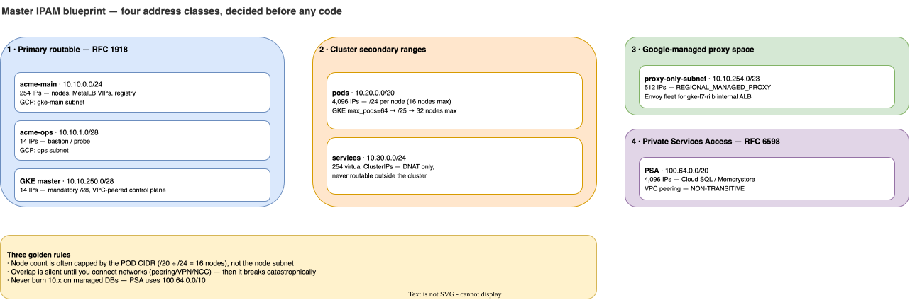
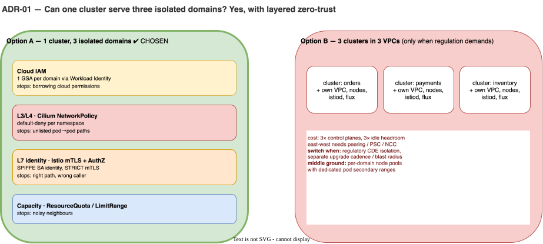
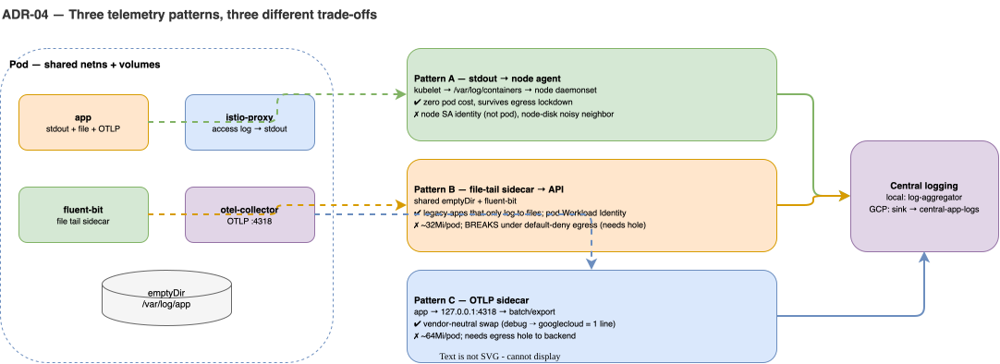
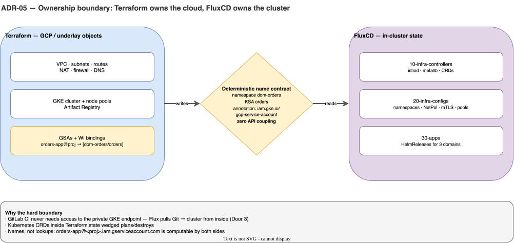

# 00 · Architecture Decision Framework & IPAM Blueprint

> **Train Your Architect Brain:** In interviews, design reviews, and production incidents, knowing *how* to run a command is 20% of the job; knowing *why* an boundary exists, what fails when it's misconfigured, and when to choose an alternative is the other 80%.

---

## 1. Master IPAM Blueprint (Memorize This Table)

Pod and Service CIDRs are **baked in at cluster creation** and painful to change later. Always allocate four distinct address classes before touching Docker, Minikube, or Terraform.

| Address Space | CIDR | Total IPs | Per-Node / Purpose | Who Allocates It? | Routable Outside Cluster? | GCP Equivalent |
|---|---|---|---|---|---|---|
| **Primary Node Subnet** | `10.10.0.0/24` | 254 | `.10` `.11` `.12` (Minikube Nodes) `.200` (Registry), `.240-.249` (MetalLB), `.250` (Router) | Docker Bridge / GCP Subnet | **Yes** (Advertised over VPN/NCC) | `google_compute_subnetwork.gke_main` |
| **Ops / Bastion Subnet** | `10.10.1.0/28` | 14 | `.2` (Router), `.3` (`probe` container) | Docker Bridge / GCP Subnet | **Yes** | `google_compute_subnetwork.ops` |
| **Pod CIDR** | `10.20.0.0/20` | 4,096 | `/24` per node locally (16 nodes max) `/25` on GKE (`max_pods_per_node=64` → 32 nodes max) | `kube-controller-manager` (`node.spec.podCIDR`) + Cilium | **No** locally (SNAT'd to Node IP) **VPC-only** on GKE (SNAT'd to On-Prem unless `ip-masq-agent` configured) | `secondary_ip_range` `gke-pods` |
| **Service CIDR** | `10.30.0.0/24` | 254 | `.1` (`kubernetes.default`), `.10` (`kube-dns`) | `kube-apiserver` | **Never** (Virtual IPs rewritten in kernel by eBPF/iptables) | `secondary_ip_range` `gke-svcs` |
| **GKE Master CIDR** | `10.10.250.0/28` | 14 | Google-managed control plane VPC peering | GKE Control Plane | VPC Peered (Non-transitive) | `master_ipv4_cidr_block` |
| **Proxy-Only Subnet** | `10.10.254.0/23` | 512 | Regional Envoy proxies for `gke-l7-rilb` | Google Managed Proxy Fleet | Internal to Region | `purpose = "REGIONAL_MANAGED_PROXY"` |
| **PSA Peering** | `100.64.0.0/20` | 4,096 | Cloud SQL Private IP (`servicenetworking`) | Google Service Producer | Non-transitive VPC Peering | `purpose = "VPC_PEERING"` (RFC 6598 saves `10.x`) |

### The 3 Golden IPAM Rules for Architects
1. **Node Capacity Is Often Capped by Pod CIDR, Not Node Subnet:** A `/20` Pod CIDR has sixteen `/24` blocks. With default Kubernetes settings (`--node-cidr-mask-size=24`, up to 110 pods/node), **your cluster cannot scale past 16 nodes** even if your node subnet has 250 free IPs! On GKE, setting `max_pods_per_node = 64` shrinks the slice to `/25` (128 IPs), doubling max nodes to 32.
2. **Overlap Is Silent Until You Connect Networks:** Two clusters with `10.20.0.0/20` run fine in isolation. The day you peer their VPCs or attach them to Cloud Router/VPN, routing breaks catastrophically.
3. **Never Burn `10.x` on Managed Databases:** Use RFC 6598 (`100.64.0.0/10`) for Private Services Access (Cloud SQL) so enterprise `10.x` ranges remain clean for VPCs and on-prem spokes.

---

## 2. Core Architectural Decision Records (ADRs)

### ADR-01: Multi-Domain Isolation — 1 Shared Cluster vs 3 Separate Clusters

| Dimension | Option A: 1 Cluster + Layered Zero-Trust (Chosen) | Option B: 3 Clusters in 3 VPCs |
|---|---|---|
| **Control Plane & Node Cost** | **1x** (Fits free-tier zonal credit; high bin-packing density) | **3x** management fees, 3x idle node headroom, 3x Istio/Flux control planes |
| **East-West Latency** | Sub-millisecond (Same VPC, Cilium eBPF direct routing) | Requires VPC Peering / NCC / Private Service Connect + cross-cluster ingress |
| **Security Boundary** | **Defense-in-Depth:** L4 eBPF (`NetworkPolicy`) + L7 Crypto Identity (`SPIFFE`) + Cloud IAM (`Workload Identity`) | Hard kernel/VPC boundary |
| **When to Switch to Option B?** | When regulatory compliance (PCI-DSS CDE vs non-CDE) mandates **separate VPC firewall tables** or teams require **independent GKE upgrade cadences**. *(Compromise: Per-domain node pools with dedicated pod secondary ranges in 1 cluster).* |

---

### ADR-02: CNI Selection — Cilium eBPF (Dataplane V2) vs Calico vs Kindnet

| Feature | Kindnet / Bridge | Calico (iptables) | Cilium eBPF / GKE Dataplane V2 (Chosen) |
|---|---|---|---|
| **Enforces `NetworkPolicy`?** | **No** (Silently ignores policies!) | Yes (via Linux `iptables`/`ipsets`) | **Yes** (In-kernel eBPF programs) |
| **Service Load Balancing** | `kube-proxy` `iptables` (O(N) rule scan) | `kube-proxy` `iptables` / IPVS | **eBPF socket-level bypass** (O(1) hash lookup) |
| **Observability** | Blind (`tcpdump` only) | Paid Enterprise or basic logs | **Hubble CLI/UI built-in** (`hubble observe --verdict DROPPED`) |
| **GCP Parity** | None | Legacy GKE Network Policy | **Exact engine powering GKE Dataplane V2 (`ADVANCED_DATAPATH`)** |

---

### ADR-03: Service Mesh — Istio Sidecar Mode vs Ambient Mode vs No Mesh

| Requirement | No Mesh (CNI Only) | Istio Ambient Mode (ztunnel) | Istio Sidecar Mode (Chosen for Training) |
|---|---|---|---|
| **Caller Identity** | IP Address / Pod Label only (Spoofable if CNI bypassed) | Cryptographic SPIFFE X.509 (`cluster.local/ns/.../sa/...`) | Cryptographic SPIFFE X.509 (`cluster.local/ns/.../sa/...`) |
| **L7 HTTP Path/Method Policy** | Limited (Cilium L7 requires Envoy DaemonSet) | Requires deploying Waypoint proxies | **Every pod has dedicated `istio-proxy` (Envoy)** |
| **Why Chosen Here?** | Lacks mTLS & SPIFFE | Hides pod-level networking mechanics | **Exposes real enterprise failure modes:** webhook ordering, `15012` xDS egress, `1/2 Ready` traps, and `STRICT` mTLS vs plaintext LBs. |

---

### ADR-04: Observability — Why 3 Telemetry Patterns in a 4-Container Pod?

| Pattern | Mechanism | Pros | Cons / Network Trap |
|---|---|---|---|
| **Pattern A: `stdout` → Node Agent** | App & Envoy write JSON to `stdout`; Kubelet writes `/var/log/containers`; node DaemonSet ships it. | Zero pod RAM overhead; works even if pod egress is locked down. | **Runs under Node SA**, not Pod SA; noisy neighbor on node disk can drop logs. |
| **Pattern B: Shared `emptyDir` + `fluent-bit` Sidecar** | App writes `/var/log/app/app.log`; `fluent-bit` tails file, enriches metadata, ships directly. | Works for legacy apps that only log to files; uses **Pod's Workload Identity**. | Costs ~32Mi RAM/pod; **breaks under Default-Deny Egress** unless collector/API port + metadata server (`169.254.169.252:988`) are allowed! |
| **Pattern C: Loopback OTLP + `otel-collector` Sidecar** | App sends traces/logs/metrics to `127.0.0.1:4318`; OTel batches, redacts PII, exports to backend. | Vendor-neutral (swap debug exporter for `googlecloud` with 1 line); offloads batching/retries from app. | Costs ~64Mi RAM/pod; requires egress hole to telemetry backend. |

---

### ADR-05: Ownership Boundary — Terraform vs FluxCD Handshake

* **Rule:** Terraform **never** runs `kubectl apply` or uses the Kubernetes/Helm Terraform providers.
* **Why?**
  1. **Security:** GitLab CI runners never need network access to the private GKE control plane (`10.10.250.0/28`). Flux pulls from inside the cluster out to GitLab over Door 3 (Cloud NAT).
  2. **State Reliability:** Broken Kubernetes CRDs inside Terraform state wedge `terraform plan/destroy`. Separating infrastructure (Terraform) from workloads (Flux) via **deterministic names** (`orders-app@<project>.iam.gserviceaccount.com`) eliminates circular dependencies.
