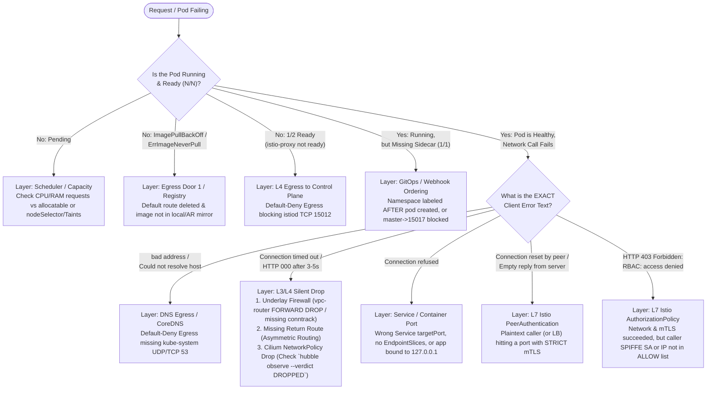

# 02 · Failure Signatures & Triage Matrix

> **Architect's Diagnostic Rule:** Different layers fail with **distinct error signatures**. Never guess or randomly edit YAML—read the exact symptom, match the layer in the decision tree below, and run the single verification command that proves it.

---

## 1. Visual Triage Decision Tree (Symptom → Root Cause Layer)

---

## 2. Master Failure Catalog (20 Production & Lab Traps)

| # | Exact Symptom / Error Text | Failing Layer | Root Cause | First Command to Prove It | Fix | Lab |
|---|---|---|---|---|---|---|
| **01** | `ping` hangs 100% loss between `probe` (`10.10.1.3`) and node (`10.10.0.10`) | **L3 Underlay Routing** | Missing forward route on `probe` OR missing return route on the Minikube node (asymmetric routing). | `docker exec vpc-router tcpdump -nn -i any icmp` (See echo request pass, or reply die) | Run `scripts/routes.sh` to add routes in **both** directions. | Lab 01 |
| **02** | Outbound SYN reaches server, SYN-ACK dropped at router (`curl` returns `000` timeout) | **L3/L4 Underlay Firewall** | `iptables -P FORWARD DROP` without a stateful `conntrack ESTABLISHED,RELATED` rule. | `docker exec vpc-router iptables -L FORWARD -n -v` | Add `-m conntrack --ctstate ESTABLISHED,RELATED -j ACCEPT` at top of `FORWARD`. | Lab 01 |
| **03** | Routing worked yesterday; after `minikube stop && start` or reboot, `probe` times out | **Container Netns Lifecycle** | Manual `ip route add` inside Minikube node containers lives in volatile kernel memory. | `docker exec acme ip route \| grep 10.10.1.0` (Empty) | Re-run `./scripts/routes.sh` after any node restart. | Lab 01 / 02 |
| **04** | Nodes stuck `NotReady` (`ContainerRuntimeNetworkNotReady: cni config uninitialized`) | **L2 CNI Bootstrap** | Cluster started without an active CNI plugin or Cilium DaemonSet pods are still initializing. | `kubectl -n kube-system get pods -l k8s-app=cilium` | Install/wait for Cilium DaemonSet rollout (`cilium status`). | Lab 02 |
| **05** | Pod IPs are in `10.0.x.x` instead of `10.20.0.0/20` despite kubeadm flag | **CNI IPAM Mode** | Cilium defaulted to `cluster-pool` IPAM instead of reading Kubernetes `node.spec.podCIDR`. | `kubectl -n kube-system exec ds/cilium -- cilium config view \| grep ipam` | Install Cilium with `--set ipam.mode=kubernetes` + `controller-manager.allocate-node-cidrs=true`. | Lab 02 |
| **06** | `wget: can't connect to remote host: Connection refused` on Service call | **L4 Service / Endpoints** | Service `targetPort` doesn't match container listening port (`8080`), or selector matches 0 pods. | `kubectl get endpointslices -n <ns>` | Match `spec.ports[].targetPort` to container port and verify pod labels. | Lab 03 |
| **07** | Cross-namespace call `http://payments/` fails with `bad address` | **CoreDNS Search Domains** | Short name `payments` only resolves in the **same** namespace. | `kubectl exec ... -- cat /etc/resolv.conf` | Use `<svc>.<ns>` (`payments.dom-payments`) or full FQDN. | Lab 03 |
| **08** | External server sees Node IP (`10.10.0.11`) instead of Pod IP (`10.20.1.x`) | **CNI SNAT / Masquerade** | Expected behavior! Pod CIDR is unroutable outside the cluster; Cilium masquerades outbound packets. | `docker logs echo --tail 5` | Expected; on GKE hybrid VPNs, configure `ip-masq-agent` non-masquerade CIDRs. | Lab 04 |
| **09** | `dig example.com` returns an IP immediately, but `curl https://example.com` hangs/times out | **L3 Egress Default Route** | CoreDNS forwards via Docker's internal resolver (`127.0.0.11`), bypassing node routes, while TCP data packets hit `No route to host`. | `docker exec acme-m02 ip route` (No `default` route) | Open Door 2 (`/32` route) or Door 3 (schedule on `allowed-open-nat` node). | Lab 04 |
| **10** | Pod stuck in `ImagePullBackOff` / `ErrImagePull` after deleting default route | **L3 Egress Dependency** | Kubelet on the worker node has no internet route to Docker Hub / registry. | `kubectl describe pod <pod>` | Preload with `minikube image load` or pull from local registry (`10.10.0.200:5000` / GCP Door 1 AR mirror). | Lab 04 |
| **11** | `wget: bad address 'payments.dom-payments'` right after applying `default-deny` NetworkPolicy | **L4 Egress Policy (DNS)** | Default-deny egress blocked UDP/TCP port `53` to `kube-system` CoreDNS. | `kubectl -n kube-system exec ds/cilium -- hubble observe --verdict DROPPED --last 10` | Apply `allow-dns` Egress NetworkPolicy to `kube-system` port 53. | Lab 05 |
| **12** | Service `orders -> payments` times out even though `NetworkPolicy` allows `port: 80` | **DNAT vs Policy Ordering** | `ClusterIP:80` is DNAT'd to `PodIP:8080` **before** NetworkPolicy evaluation. Policy must allow **pod port `8080`**. | `kubectl -n kube-system exec ds/cilium -- hubble observe --verdict DROPPED` (Shows dst port `8080`) | Change `NetworkPolicy` port from `80` to `8080`. | Lab 05 |
| **13** | Pods stuck `1/2 Ready` after enabling `istio-injection=enabled` | **L4 Egress vs Mesh Bootstrap** | `istio-proxy` sidecar cannot reach `istiod.istio-system:15012` (xDS) due to `default-deny` egress policy. | `kubectl -n dom-orders logs deploy/orders -c istio-proxy --tail=10` | Add egress rule to namespace `istio-system` on TCP ports `15012`, `15014`. | Lab 06 |
| **14** | Namespace has `istio-injection=enabled`, but pods only have `1/1` containers | **Admission Webhook Timing** | Mutating webhook runs **only at Pod creation time**. Labeling a namespace does not mutate existing pods. | `kubectl -n dom-orders get pods` | Run `kubectl -n <ns> rollout restart deploy` (In GitOps: enforce `infra-configs` before `apps`). | Lab 06 / 09 |
| **15** | `curl: (56) Recv failure: Connection reset by peer` or empty reply | **L7 Istio mTLS (`STRICT`)** | Caller has no Envoy sidecar (or is an external LoadBalancer) sending plaintext HTTP to a `STRICT` mTLS workload. | `istioctl x describe pod <target-pod> -n dom-payments` | Mesh the caller, OR add workload `PeerAuthentication` with `portLevelMtls: {8080: {mode: PERMISSIVE}}`. | Lab 06 / 08 |
| **16** | `HTTP/1.1 403 Forbidden` with body `RBAC: access denied` | **L7 Istio AuthZ (`SPIFFE`)** | Network path and mTLS succeeded, but caller's ServiceAccount (`intruder`) or plaintext IP is not allowed by `AuthorizationPolicy`. | `kubectl -n dom-payments logs deploy/payments -c istio-proxy --tail=10` | Use authorized ServiceAccount (`orders`) or add source `ipBlocks` for ingress gateway/LB. | Lab 06 / 08 |
| **17** | `fluent-bit` sidecar CrashLoops: `cannot open configuration file: parsers.conf` | **Volume Mount Shadowing** | Mounting a ConfigMap onto `/fluent-bit/etc` without `subPath` wipes out all existing files (`parsers.conf`) in that directory. | `kubectl -n dom-orders logs deploy/orders -c fluent-bit` | Mount with `mountPath: /fluent-bit/etc/fluent-bit.conf` and `subPath: fluent-bit.conf`. | Lab 07 |
| **18** | `fluent-bit` runs cleanly, app writes `/var/log/app/app.log`, but central aggregator shows nothing | **Sidecar Egress Hole** | Sidecars share the Pod network namespace! `default-deny` egress blocks TCP `24224` to `observability` (or `169.254.169.252:988` on GKE). | `kubectl -n kube-system exec ds/cilium -- hubble observe --from-namespace dom-orders --verdict DROPPED` | Add Egress NetworkPolicy from `dom-*` to `observability` on port `24224`. | Lab 07 |
| **19** | Envoy access log on `payments-lb` shows Node IP (`10.10.0.10`) instead of client `10.10.1.3`, causing `ipBlocks` AuthZ `403` | **Service SNAT (`Cluster` policy)** | Default `externalTrafficPolicy: Cluster` bounces traffic across nodes with SNAT, erasing client source IP. | `kubectl -n dom-payments get svc payments-lb -o yaml` | Set `externalTrafficPolicy: Local` on the `LoadBalancer` Service. | Lab 08 |
| **20** | Flux `infra-configs` fails: `no matches for kind "IPAddressPool" in version "metallb.io/v1beta1"` | **GitOps CRD Race Condition** | Flux applied Custom Resources (`infra-configs`) before CustomResourceDefinitions (`infra-controllers`) were established. | `flux get kustomizations` | Add `dependsOn: [{name: infra-controllers}]` on `infra-configs` and `wait: true` on `infra-controllers`. | Lab 09 |
| **21** | Pod `STATUS: CrashLoopBackOff`, restart count climbing | **App / Config** | Container exits non-zero repeatedly: bad command, missing file/env, or unreachable dependency. Backoff is a symptom, not the cause. | `kubectl logs <pod> --previous` + `kubectl describe pod <pod>` | Fix what `--previous` logs / describe events show; check the last exit code. | Lab 03 |
| **22** | Pod `STATUS: OOMKilled` — "app randomly restarts" | **Memory Limits** | Container crossed its `limits.memory` cgroup ceiling; kernel kills it instantly (no graceful shutdown, logs truncated). | `kubectl describe pod <pod>` → `Last State: OOMKilled` | Raise `limits.memory` or fix the leak; remember sidecars multiply per-pod usage. | Lab 03 / 07 |
| **23** | Pod stuck `Pending` — never starts, no container events | **Scheduler / Capacity** | Requests exceed node allocatable, `nodeSelector` matches nothing, un-tolerated taints, or unbound PVC. | `kubectl describe pod <pod>` → Events (`Insufficient cpu`) | Lower requests, add nodes, fix selectors/taints/PVC. | Lab 03 |
| **24** | Pod `Running` but `0/1 Ready`; Service calls fail although pod is "up" | **Readiness Probe / Endpoints** | Failing readiness probe removes the pod from the EndpointSlice → Service has no backends. | `kubectl get endpoints <svc>` (empty) + `describe` probe events | Fix probe port/path/initialDelay; on GKE the same mechanism → LB `502` when health checks fail. | Lab 03 / 08 |
| **25** | `CreateContainerConfigError` / `MountVolume.SetUp failed` | **ConfigMap / Secret Reference** | Pod spec references a ConfigMap or Secret that doesn't exist (or envFrom name typo) in the namespace. | `kubectl describe pod <pod>` → "secret/configmap not found" | Create the object in the same namespace or fix the reference name. | Lab 03 |
| **26** | `ImagePullBackOff` on a **private** registry while egress is fine | **Registry Auth** | Kubelet can reach the registry but has no credentials: missing `imagePullSecrets`. | `kubectl describe pod <pod>` → `401 Unauthorized` | Add `imagePullSecrets`; on GKE it's the node SA's `artifactregistry.reader` role instead (no pull secret needed). | Lab 03 / 04 |
