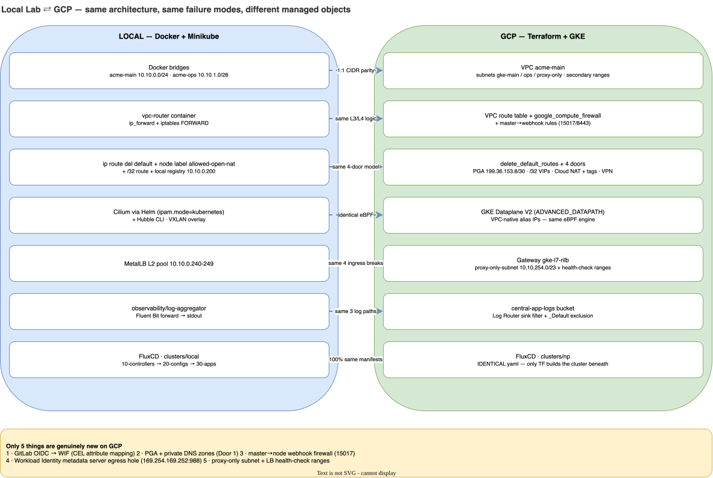

# 03 · Local-to-GCP GKE Rosetta Stone

> **Zero Surprises on Cloud Day:** Use this side-by-side translation guide when moving from your local Docker + Minikube labs (Labs 01–10) to the GCP Terraform + GKE stack (`acme-labs-plan.md` Phases P0–P9).

---

## 1. Visual Architecture Mapping: Local Lab ⇄ GCP Production

---

## 2. Component-by-Component Translation Table

| Architectural Layer | Local Lab Implementation | GCP GKE Implementation | What Transfers 100% | What Is New on GCP (Focus Here in P1–P9) |
|---|---|---|---|---|
| **VPC & Subnets** | `docker network create acme-main` (`10.10.0.0/24`) & `acme-ops` (`10.10.1.0/28`) | `google_compute_network` (`delete_default_routes_on_create=true`) + `google_compute_subnetwork` | Primary CIDR layout, non-overlapping IPAM rules | Secondary ranges (`gke-pods`, `gke-svcs`), `proxy-only-subnet` (`10.10.254.0/23`), Master `/28` (`10.10.250.0/28`) |
| **Routes & Next Hops** | `ip route add ... via 10.10.0.250` on nodes & `probe` | `google_compute_route` resources with priorities (`900`, `999`) | Longest-prefix match, asymmetric routing failure mode | `next_hop_gateway = "default-internet-gateway"` is required for Cloud NAT to trigger |
| **L3/L4 Firewall** | `iptables -P FORWARD DROP` on `vpc-router` | `google_compute_firewall` rules on VPC | Stateful connection tracking, Authorized Networks concept | **Master → Node Webhook firewall** (`10.10.250.0/28` → `15017, 8443, 9443`), Google LB health-check ranges (`130.211.0.0/22`, `35.191.0.0/16`) |
| **Bastion / Admin Probe** | `probe` container (`10.10.1.3`) in `acme-ops` | `e2-micro` VM in `ops` subnet (`--no-address`, tag `iap-ssh`) | Testing API server & Internal LB from a separate subnet | **Identity-Aware Proxy (IAP)** TCP forwarding (`35.235.240.0/20` → port 22) |
| **Cluster & Node Pools** | `minikube start -p acme --nodes=3` + `kubectl label node pool=main` | `google_container_cluster` (Standard, Zonal, Private) + `google_container_node_pool` (Spot `e2-standard-2`) | `max_pods_per_node` math, node labels, resource allocatable math | `enable_private_nodes = true`, `master_authorized_networks_config`, dedicated least-privilege Node GSA (`gke-nodes`) |
| **Pod Networking (CNI)** | Cilium via Helm (`ipam.mode=kubernetes`, VXLAN/host routing) | GKE Dataplane V2 (`networking_mode = "VPC_NATIVE"`, `ADVANCED_DATAPATH`) | Cilium `NetworkPolicy` enforcement, Hubble verdicts | **Alias IPs:** GCP VPC natively routes `10.20.0.0/20` without overlay encapsulation inside the VPC |
| **Door 1: Private Cloud APIs & Registry** | Local registry (`10.10.0.200:5000`) + `/32` route | **Private Google Access (PGA)** + Route `199.36.153.8/30` + Private Cloud DNS (`*.googleapis.com`, `*.pkg.dev` → `private.googleapis.com`) | Pulling images & shipping logs when `0.0.0.0/0` is deleted | Private DNS CNAME wildcard zones + Artifact Registry Remote Repository (`dockerhub-mirror`) |
| **Door 2: /32 VIP Allow-List** | `ip route add $VIP/32 via 10.10.0.1` | `google_compute_route` per IP in `var.vip_allowlist` (priority `900`) | Exact `/32` longest-prefix override over deleted default route | Combined with Cloud NAT static IPs so partner APIs can allow-list your egress IP |
| **Door 3: Tag-Gated Internet Egress** | Node label `allowed-open-nat=true` + default route on `acme-m03` only | `google_compute_route` (`0.0.0.0/0`, priority `999`, `tags = ["allowed-open-nat"]`) + Cloud NAT (`ALL_IP_RANGES`) | **Pods inherit their node's egress route/tag!** Tags cannot filter per-pod. | Cloud NAT `MANUAL_ONLY` with 2 reserved `google_compute_address` static IPs |
| **Door 4: Hybrid / On-Prem** | Route to `10.10.1.0/28` via `10.10.0.250` (`vpc-router`) | HA VPN + Cloud Router BGP to `onprem-sim` VPC (`192.168.100.0/24`) |Unaffected by deleting default internet route; masquerade trap | `ip-masq-agent` config so pod IPs are SNAT'd to node IPs (or advertise pod CIDR over BGP) |
| **Cloud / Pod Identity** | Kubernetes `ServiceAccount` (`orders`, `payments`, `inventory`) | **GKE Workload Identity** (`KSA` annotated with `iam.gke.io/gcp-service-account: orders-app@...`) | SPIFFE identity (`cluster.local/ns/dom-orders/sa/orders`) for Istio | **Critical Trap:** Default-deny egress blocks GKE Metadata Server (`169.254.169.252:988`)—must explicitly allow it in `NetworkPolicy`! |
| **CI/CD Identity** | Local CLI / GitLab PAT | **Workload Identity Federation (WIF)** OIDC Pool + CEL attribute condition (`root_group_ref = <root>:main:true`) | Zero long-lived JSON service account keys | Branch protection enforced in **Google IAM principalSet** (`pipeline-p` vs `pipeline-p-ro`), not just GitLab UI |
| **Observability** | `app` + `istio-proxy` + `fluent-bit` + `otel-collector` → `log-aggregator` | Same 4-container pod (`stackdriver` / `googlecloud` exporters) → Cloud Logging Sink → `central-app-logs` | Volume mounts (`emptyDir`, `subPath`), resource requests, Egress holes | Log Router sink filter (`namespace_name=~"^dom-"`), `_Default` bucket exclusion to avoid paying twice |
| **North-South Entry** | `Service type: LoadBalancer` (MetalLB `10.10.0.240`) | Kubernetes `Gateway` (`gatewayClassName: gke-l7-rilb`) + `HTTPRoute` | **All 4 ingress breaks** (Firewall → NetPol → STRICT mTLS → AuthZ) | Google-managed Envoy proxies live in `proxy-only-subnet` (`10.10.254.0/23`); firewall must allow `10.10.254.0/23` → nodes |
| **GitOps Delivery** | FluxCD bootstrapping `clusters/local` (`10-controllers` → `20-configs` → `30-apps`) | FluxCD bootstrapping `clusters/np` | **100% identical YAML structure and `dependsOn` ordering** | Helm charts pulled from Artifact Registry OCI (`oci://us-central1-docker.pkg.dev/...`) |
| **Live packet capture** | `docker exec vpc-router tcpdump -nn -i any` | **VPC Flow Logs** (`log_config` on subnet) + Packet Mirroring | Same packet-level verdict on "did the packet even arrive" | Flow logs are aggregated metadata (5-tuple + verdict), not full payloads; enable per-subnet in P3 |
| **Reachability simulation** | Hubble `hubble observe --verdict DROPPED` | **Network Intelligence Connectivity Tests** (`gcloud network-management connectivity-tests create`) | Names which route/firewall decides a packet | GCP tests are *simulated* (config analysis), not real packets — combine with flow logs |
| **Pod event triage** | `kubectl get pods → describe pod → logs --previous` | Identical `kubectl` + GKE console Events tab | The entire debug flow transfers unchanged | Events also surface in Cloud Logging (`k8s_event`) |
| **LB backends** | MetalLB L2 VIP → kube-proxy → pod | Google LBs → **NEGs** (Network Endpoint Groups: pods are LB backends directly) | VIP → pod semantics | No NodePort hop; `502` almost always = failing health checks (wrong path/port or blocked `130.211.0.0/22` + `35.191.0.0/16`) |
| **`.env` / secrets** | K8s `Secret` + `envFrom`/`secretKeyRef` | **Secret Manager** + External Secrets Operator (or CSI driver) | Same pod-level env/volume injection | ESO syncs Secret Manager → K8s `Secret`; audit + rotation are the real wins |
| **Registry auth** | Open local registry (`10.10.0.200:5000`) | Artifact Registry via **node SA** `artifactregistry.reader` | Pull without `imagePullSecrets` | Pull secrets replaced by node/workload identity; AR mirror keeps Door 1 egress-only |
| **Metrics & dashboards** | none — logs only (aggregator) | **Cloud Monitoring** — Golden Signals: latency, traffic, errors, saturation | — | Genuinely new: `monitoring_config` + Managed Prometheus / dashboards (P6) |
| **Distributed tracing** | `otel-collector` → `debug` exporter (spans to stdout) | **Cloud Trace** via `googlecloud` exporter | Same OTLP instrumentation & pipeline | Correlate logs↔traces with `trace` field in log entries; swap is one exporter line |

---

## 3. The 6 Genuinely New Things You Only Encounter on GCP

Once you complete **Labs 01–10** locally, **85% of your GKE platform is already built and debugged**. When you switch to `acme-labs-plan.md`, focus your energy on these 6 cloud-only mechanics:

1. **GitLab OIDC → GCP Workload Identity Federation (P1–P2):** Writing the CEL expression `assertion.project_path.split('/')[0] + ':' + assertion.ref + ':' + assertion.ref_protected` so feature branches cannot impersonate `pipeline-p`.
2. **Private Google Access + Private DNS Zones (P3 & P8 - Door 1):** Routing `199.36.153.8/30` to `default-internet-gateway` and creating Private Cloud DNS zones for `googleapis.com.`, `gcr.io.`, and `pkg.dev.`.
3. **Private Control Plane Webhook Firewall Rule (P3 & P5):** Allowing GKE's private master CIDR (`10.10.250.0/28`) to reach worker nodes on TCP `15017` (`istiod` mutating webhook) and `8443/9443`.
4. **GKE Metadata Server Egress Hole for Workload Identity (P7):** Adding `ipBlock: 169.254.169.252/32` port `988` to every namespace's baseline Egress `NetworkPolicy` so `fluent-bit` and `otel-collector` can fetch GCP OAuth tokens.
5. **Regional Managed Proxy Subnet & Health Check Ranges (P3 & P9):** Provisioning `10.10.254.0/23` (`REGIONAL_MANAGED_PROXY`) and opening VPC firewalls + NetworkPolicies for `130.211.0.0/22` and `35.191.0.0/16`.
6. **Managed Observability Stack (P6):** Cloud Logging `gcloud logging read` filters (`resource.type="k8s_container" severity>=ERROR`), Cloud Monitoring Golden Signals dashboards, Cloud Trace with log↔trace correlation, and VPC Flow Logs as your `tcpdump` replacement.
