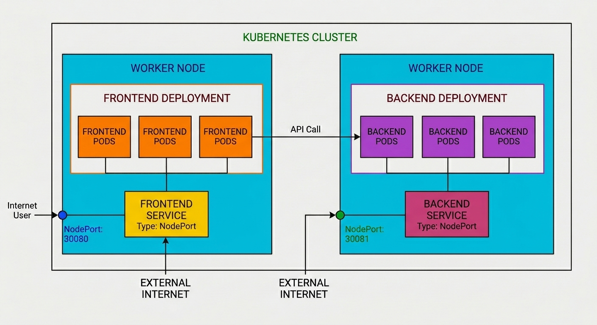
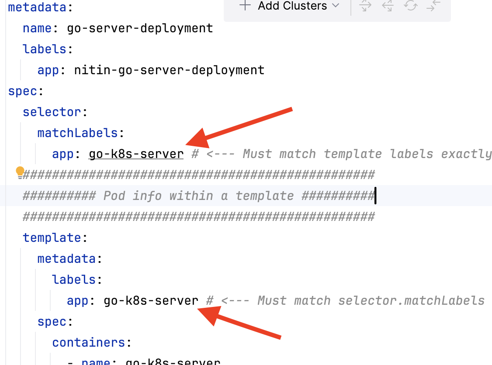
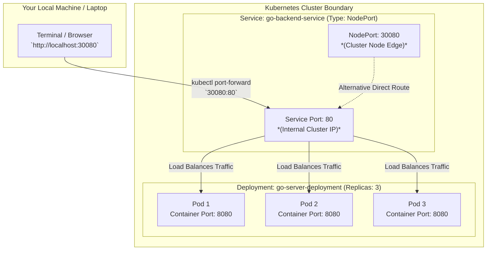

No Ingress needed

**No.** Frontend-to-backend communication happens entirely **inside** the cluster using Kubernetes internal DNS.

* **Internal Traffic (Frontend to Backend):** Uses cluster DNS (`http://go-backend-service:80`). You **do not** need Ingress for this.
* **External Traffic (You in your browser to the Frontend):** Uses `NodePort` (`http://localhost:30081`) or an Ingress controller if you want a clean domain name (like `myapp.local`) instead of a node port.


## Deploy backend 

```shell
kubectl apply -f backend-deployment.yml

# Expose via thr service
kubectl port-forward svc/go-backend-service 30080:80
```

**The Traffic Flow:**

`External Request (localhost:30080) -> NodePort (30080) -> Service Port (80) -> Target Container Port (8080)`

## Port forwarding

### 1. Forwarding to the Service (svc/go-backend-service)

```shell
kubectl port-forward svc/go-backend-service 30080:80
```

### 2. Forwarding to a Pod directly (pod/go-server-xyz)
```shell
kubectl port-forward pod/go-server-abc123 30080:8080
```

